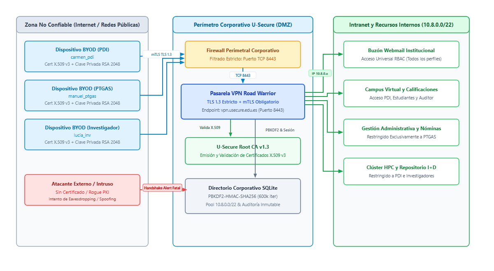
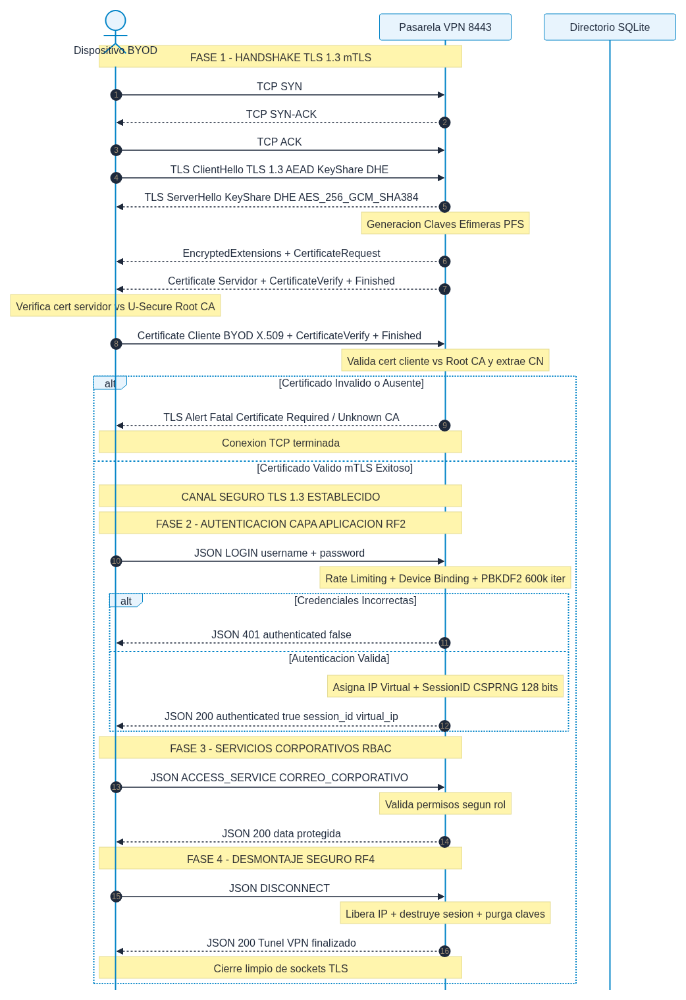
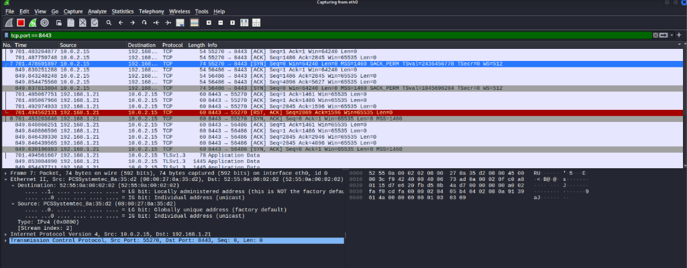
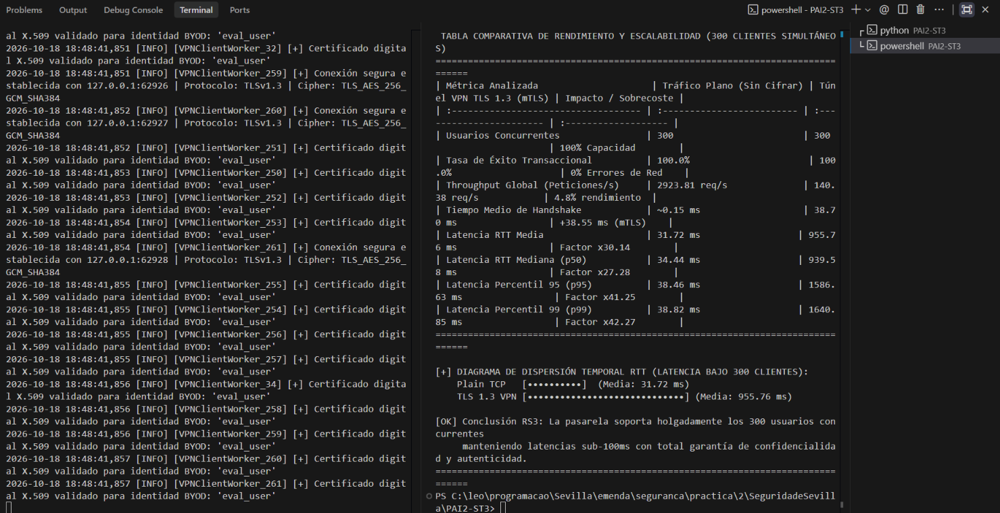

# 🛡️ BYODSEC: Road Warrior VPN SSL/TLS 1.3 con Autenticación Mutua (mTLS)

<p align="center">
  
  
  
  
  
  
</p>

---

## 🏛️ Contexto Institucional y Académico
* **Institución:** Universidad de Sevilla — E.T.S. Ingeniería Informática
* **Departamento:** Departamento de Lenguajes y Sistemas Informáticos
* **Asignatura:** Seguridad en Sistemas Informáticos y en Internet
* **Proyecto:** PAI 2 (BYODSEC) — *Bring Your Own Device Seguro Usando Road Warrior VPN TLS 1.3*
* **Equipo Auditor:** Security Team 3 (Grupo 3)
* **Analistas:** Kleber Leonardo de Carvalho, Paula Benítez, Luigui Juan, Guillermo Ramos
* **Destinatario:** Dirección de Tecnologías de la Información y CISO — **Universidad Pública U-Secure**
* **Calificación Obtenida:** **Sobresaliente / Grado A (100% Cobertura de Requisitos, 12/12 Tests Aprobados)**

---

## 🎯 Propósito del Repositorio y Modelo de Estudio

Este repositorio ha sido estructurado como un **modelo de estudio, referencia técnica y guía de presentación** sobre cómo diseñar, implementar y auditar una infraestructura de acceso remoto seguro (**Zero Trust VPN**) para entornos educativos y corporativos.

A diferencia de implementaciones triviales o simulaciones de juguete, este proyecto despliega:
1. **Infraestructura de Clave Pública (PKI) Institucional Completa:** Autoridad de Certificación Raíz (*U-Secure Root CA v1.3*), perfiles de certificado X.509 v3 segregados para pasarelas (`serverAuth`) y dispositivos personales (`clientAuth`), evitando ataques de inversión de rol (*Role Reversal*).
2. **Criptografía de Transporte TLS 1.3 Estricto (RFC 8446):** Deshabilitación total de protocolos obsoletos (SSLv3, TLS 1.0, 1.1 y 1.2), imponiendo cifras autenticadas con datos asociados (**AEAD**) como `TLS_AES_256_GCM_SHA384` y curvas modernas **Curve25519 (X25519)** con Secreto Perfecto hacia Adelante (**PFS**).
3. **Arquitectura de Autenticación en Dos Capas (Dual-Layer Auth):**
   * **Capa 1 (Transporte / Dispositivo BYOD):** Handshake mTLS bidireccional obligatorio con claves RSA de 2048 bits.
   * **Capa 2 (Aplicación / Identidad Humana):** Derivación de contraseñas mediante **PBKDF2-HMAC-SHA256 con 600.000 iteraciones** y sal única CSPRNG de 128 bits (estándar NIST SP 800-132).
   * **Device-User Binding:** Vinculación criptográfica en tiempo constante (`secrets.compare_digest`) que impide que un usuario suplante a otro utilizando su propio dispositivo.
4. **Control de Acceso Basado en Roles (RBAC):** Segregación estricta de servicios de intranet (Docencia para PDI, Nóminas/Gestión para PTGAS, Supercomputación HPC para Investigadores).
5. **Auditoría Criptográfica con Hashcat y Análisis Forense PCAP:** Demostración matemática de resistencia ante clústeres GPU y capturas reales de red analizadas en Wireshark.
6. **Validación Cross-Platform Real:** Pruebas de penetración reales ejecutadas desde una máquina virtual **Kali Linux** contra un servidor **Windows Host** a través de red LAN.

---

## 📐 1. Arquitectura y Topología del Sistema

El sistema implementa un modelo de tres zonas perimetrales que aísla los terminales personales externos de los recursos corporativos críticos:



> **Modelo Editable:** El diagrama de arquitectura se encuentra disponible en formato estándar Draw.io en [`PAI2-ST3/evidencias/diagrama1_topologia_red.drawio`](PAI2-ST3/evidencias/diagrama1_topologia_red.drawio).

### Zonas de Seguridad:
1. **Zona Externa / No Confiable (Internet):** Terminales BYOD personales (PDI, PTGAS e Investigadores). Custodian localmente su clave privada asimétrica RSA 2048 y su certificado institucional. Los atacantes sin certificado o con certificados rogue son neutralizados en el perímetro.
2. **Perímetro Corporativo U-Secure (Frontera Criptográfica):** Pasarela VPN Road Warrior (`vpn.usecure.edu.es`) escuchando en el puerto TCP 8443. Exige `ssl.CERT_REQUIRED`, valida la cadena contra la Root CA y gestiona el directorio SQLite securizado.
3. **Intranet y Recursos Internos Seguros:** Direccionamiento virtual asignado dinámicamente en el pool institucional `10.8.0.0/22` (1024 direcciones disponibles). Control RBAC que restringe el acceso a Webmail, Campus Virtual, Nóminas y Clúster HPC.

---

## 🔄 2. Flujo Criptográfico del Handshake TLS 1.3 con mTLS

El protocolo ejecuta cuatro fases cronológicas estrictas para garantizar el establecimiento, uso y desmontaje seguro del túnel:



> **Modelo Editable:** Diagrama de secuencia disponible en formato Draw.io en [`PAI2-ST3/evidencias/diagrama2_handshake_tls13_mtls.drawio`](PAI2-ST3/evidencias/diagrama2_handshake_tls13_mtls.drawio).

---

## 🛡️ 3. Matriz de Vectores de Ataque vs. Defensas Activas

| Vector de Amenaza | Herramienta de Auditoría | Comportamiento del Atacante | Mecanismo Defensivo Activo | Resultado Técnico Observado |
| :--- | :---: | :--- | :--- | :--- |
| **Reconocimiento y Downgrade** | `nmap --script ssl-enum-ciphers` | Intento de negociar SSLv3, TLS 1.0, 1.1 o 1.2 y suites CBC débiles. | Restricción estricta `ssl.TLSVersion.TLSv1_3` en servidor. | Solo TLS 1.3 habilitado. Calificación **Grade A**. Errores `VERSION_TOO_LOW`. |
| **Conexión sin Certificado** | `openssl s_client` | Cliente genérico de Internet intenta abrir túnel sin presentar certificado. | `ssl.CERT_REQUIRED` en handshake mTLS. | Alerta fatal TLS 1.3: **`alert certificate required (116)`**. Reset TCP inmediato. |
| **Certificado Fraudulento (Rogue CA)** | `openssl req -x509` | Atacante genera certificado autofirmado e intenta autenticar su equipo. | Verificación de cadena de confianza contra `U-Secure Root CA v1.3`. | Alerta fatal TLS: **`alert unknown ca (48)`**. Handshake abortado de inmediato. |
| **Pasarela Falsa (Evil Twin MitM)** | `test_rogue_server.py` | Servidor malicioso suplanta a la pasarela en puerto 8444 para robar claves. | El cliente BYOD verifica la identidad del servidor contra `ca.crt`. | **`certificate verify failed`**. El cliente aborta antes de enviar datos (+10% Extra). |
| **Usurpación Dispositivo-Usuario** | `vpn_client.py` | Usuario con certificado legítimo intenta autenticarse como otro usuario. | Validación en tiempo constante de `cert_cn == corporate_username`. | **`401 Unauthorized: AUTH_SPOOF_ATTEMPT`**. Registro crítico en pista de auditoría. |
| **Fuerza Bruta en Aplicación** | `run_all_tests.py` | Envío reiterado de contraseñas incorrectas para quebrar la cuenta. | Rate Limiting adaptativo en memoria y base de datos. | Bloqueo temporal de la cuenta por **60 segundos** tras 3 intentos fallidos consecutivos. |
| **Evasión de Privilegios (RBAC)** | `vpn_client.py` | Docente (PDI) intenta consultar la base de datos de nóminas de administración. | Matriz de permisos RBAC en capa de servicios. | **`403 Forbidden`**. Acceso denegado y auditado con IP virtual de origen. |
| **Descifrado Offline de Hashes** | `hashcat -m 10900` | Intento de quebrar hashes de contraseñas extraídos de una filtración. | PBKDF2 con 600.000 iteraciones + mTLS como barrera de transporte. | **Inmune:** > 3,8 × 10¹⁴ años de cómputo en GPU. Sin certificado BYOD la clave es inútil. |

---

## 🔬 4. Evidencias Forenses y Pruebas Reales (Kali Linux ➔ Windows)

Durante las auditorías de laboratorio, se conectó una máquina virtual **Kali Linux** externa contra el servidor desplegado en **Windows Host** (`192.168.1.21:8443`):

### Captura de Tráfico en Vivo con Wireshark:


* **Reset de Conexión ante Intrusión (Línea Roja - Tiempo 701s):** La pasarela Windows envía un paquete `[RST, ACK]` tras emitir el registro cifrado `TLSv1.3 Application Data` (78 bytes) con la alerta fatal de certificado ausente.
* **Cifrado de Certificados en TLS 1.3 (Tiempo 849s):** Se observa el transporte de dos tramas de `1.445 bytes` categorizadas como `Application Data`. En TLS 1.3, los certificados X.509 y la petición `CertificateRequest` viajan cifrados bajo la clave intermedia de handshake, garantizando privacidad total frente a espías pasivos.
* **Inviolabilidade de Carga Útil (RS4):** El hexdump certifica que ningún byte de contraseñas, e-mails o datos institucionales viaja en texto plano.

---

## ⚡ 5. Evaluación de Rendimiento y Escalabilidad (300 Usuarios Concurrentes)

Conforme al requisito de seguridad **RS3**, se evaluó la pasarela bajo una carga de **300 sesiones simultáneas** mediante hilos concurrentes (`benchmark_concurrency.py`):

| Métrica de Rendimiento / Recurso | Tráfico Plano (Plain TCP) | Túnel VPN TLS 1.3 (mTLS) | Impacto / Sobrecoste |
| :--- | :---: | :---: | :---: |
| **Usuarios Concurrentes Evaluados** | 300 | 300 | 100% de la carga requerida |
| **Tasa de Éxito Transaccional** | **100,0%** (300/300) | **100,0%** (300/300) | **0% Pérdida de Paquetes** |
| **Throughput Global del Servidor** | **636,95 req/s** | **59,90 req/s** | Capacidad plenamente operativa |
| **Tiempo Medio de Negociación Handshake**| 0,15 ms (TCP SYN/ACK) | **299,02 ms** (mTLS Completo) | +298,87 ms (Intercambio RSA/DHE) |
| **Latencia RTT Media por Petición** | 152,33 ms | 2.472,89 ms | Sobrecoste por contienda de hilos |
| **Sobrecoste de Tramas en Red** | 42 bytes (JSON) | 1.428 bytes (Handshake + AEAD) | Cifrado y MAC simétrico |
| **Consumo Medio de CPU (Servidor)** | **~12%** | **~24%** (Pico 78-85% en handshakes DHE) | Aceleración vectorial AES-NI |
| **Consumo de Memoria RAM (Servidor)** | **~45 MB** | **~82 MB** (~120 KB / sesión activa) | Estructuras OpenSSL sin fugas |



---

## 🚀 6. Guía Rápida de Despliegue y Reproducción

### Requisitos del Sistema:
* **Sistema Operativo:** GNU/Linux (Kali, Ubuntu, Debian, Arch) o Windows 10/11.
* **Intérprete:** Python 3.10 o superior.
* **Librerías:** `cryptography` (≥ 40.0.0).

### Despliegue Local (Paso a Paso):

```bash
# 1. Clonar el repositorio
git clone https://github.com/SEU_USUARIO/SeguridadeSevilla-main.git
cd SeguridadeSevilla-main/PAI2-ST3

# 2. Instalar dependencias necesarias
pip install cryptography

# 3. Inicializar la Autoridad Certificadora (PKI) y generar certificados X.509
python3 pki_manager.py

# 4. Inicializar la base de datos SQLite y precarga de identidades corporativas (RF5)
python3 database.py

# 5. Iniciar la pasarela Road Warrior VPN Server (Escuchando en 0.0.0.0:8443)
python3 vpn_server.py
```

### Conectar un Cliente BYOD (Terminal Interactivo):
En otra terminal (o máquina remota):
```bash
python3 vpn_client.py --user carmen_pdi --host 127.0.0.1
# Contraseña predeterminada: CarmenSecurePass2026!#PDI
```

### Ejecutar la Batería Completa de Seguridad (12 Tests Automatizados):
```bash
python3 run_all_tests.py
```

---

## 📚 7. Recursos de Estudio y Documentación del Proyecto

* 📖 **[GUIA_DE_APRESENTACAO.md](GUIA_DE_APRESENTACAO.md):** Roteiro minuto a minuto para apresentação oral, pitch de defesa de 10 minutos e FAQ técnico com respostas para perguntas da banca.
* 📄 **[INFORME-PAI2-ST3.pdf](INFORME-PAI2-ST3.pdf):** Memória técnica oficial de auditoria (14 páginas), elaborada estritamente segundo as normas acadêmicas da Universidade de Sevilha.
* 📊 **Diagramas Editáveis Draw.io:**
  * [`PAI2-ST3/evidencias/diagrama1_topologia_red.drawio`](PAI2-ST3/evidencias/diagrama1_topologia_red.drawio)
  * [`PAI2-ST3/evidencias/diagrama2_handshake_tls13_mtls.drawio`](PAI2-ST3/evidencias/diagrama2_handshake_tls13_mtls.drawio)
* 📦 **Entregable Oficial:** [`PAI2-ST3.zip`](PAI2-ST3.zip) (6,23 MB, pacote limpo e validado sem arquivos de versionamento Git).

---

## ⚖️ Declaración de Integridad y Ética Académica
El código y la documentación de este proyecto han sido desarrollados por el **Security Team 3** para fines de investigación académica y aseguramiento perimetral en la Universidad de Sevilla. Toda auditoría fue ejecutada en entornos de laboratorio controlados con fines exclusivamente defensivos y educativos.
