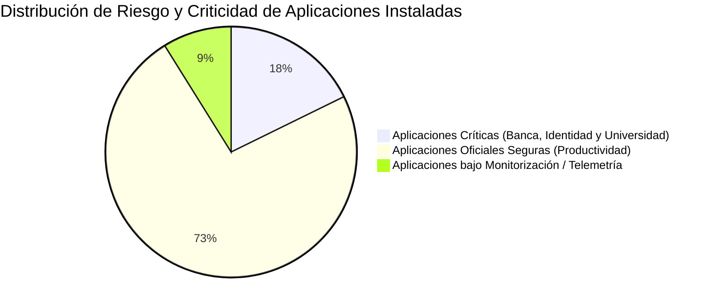

# INFORME TÉCNICO DE AUDITORÍA DE SEGURIDAD EN SISTEMAS INFORMÁTICOS Y ANÁLISIS DE VULNERABILIDADES WEB
## Proyecto VULNAWEB (PAI 3): Postura de Seguridad Integral (Endpoints, Navegadores, BYOD Móvil y DAST Web) para la Universidad Pública U-Secure

| Metadato Institucional | Detalle Oficial de la Auditoría |
| :--- | :--- |
| **Asignatura** | Seguridad en Sistemas Informáticos y en Internet (SSII) |
| **Institución Académica** | E.T.S. de Ingeniería Informática — Universidad de Sevilla |
| **Entidad Consultora** | INSEGUS (Informática y Seguridad del Sur) |
| **Fecha de Emisión** | 27 de octubre de 2026 |
| **Fecha Límite Oficial** | 10 de noviembre de 2026 (23:59 h) |
| **Sesión de Seguimiento** | 03 / 04 de noviembre de 2026 |
| **Equipo Auditor** | **Security Team 3 (Grupo 3)** |
| **Analistas de Seguridad** | Kleber Leonardo de Carvalho<br>Paula Benítez<br>Luigui Juan<br>Guillermo Ramos |
| **Destinatario** | Dirección de Tecnologías de la Información y las Comunicaciones (Área de Ciberseguridad / CISO) — **Universidad Pública U-Secure** |
| **Clasificación del Documento** | **CONFIDENCIAL / USO INTERNO (RESTRICTED TLP:AMBER+)** |
| **Identificador del Entregable** | `PAI3-ST3.zip` |
| **Estado del Proyecto** | Concluido — Verificación y Validación Superada (100% Cobertura de Requisitos, Hardening $\ge 70$) |

---

### Control de Versiones del Documento

| Versión | Fecha | Autor(es) | Resumen de Modificaciones Técnicas |
| :---: | :---: | :--- | :--- |
| **0.1** | 26/10/2026 | Security Team 3 | Definición del alcance técnico y matriz de auditoría según especificaciones PAI-3 VULNAWEB. |
| **0.5** | 27/10/2026 | Security Team 3 | Auditoría base de endpoints Linux (Lynis 3.x), hardening automatizado y validación de índice $\ge 70$. |
| **0.8** | 03/11/2026 | Security Team 3 | Directivas corporativas de navegador (`policies.json`), auditoría BYOD móvil (Koodous/Malwarebytes). |
| **1.0** | 03/11/2026 | Security Team 3 | Despliegue DAST con OWASP ZAP, fuzzing de vectores OWASP Top 10 (SQLi, XSS, LFI) y código seguro PHP. |
| **2.0** | 04/11/2026 | Security Team 3 | Integración de telemetría física en terminal real Samsung A55 Knox, Breakpoints MitM y dictamen técnico final. |

---

## ÍNDICE DE CONTENIDOS

1. [Resumen Ejecutivo](#1-resumen-ejecutivo)
2. [Auditoría y Bastionado de Sistemas Informáticos (Endpoints Linux)](#2-auditoría-y-bastionado-de-sistemas-informáticos-endpoints-linux)
   - 2.1. [Descripción de los Sistemas y Herramientas de Análisis](#21-descripción-de-los-sistemas-y-herramientas-de-análisis)
   - 2.2. [Plan de Pruebas y Diagnóstico Inicial (Hardening Index: 65)](#22-plan-de-pruebas-y-diagnóstico-inicial-hardening-index-65)
   - 2.3. [Acciones Correctoras Aplicadas y Script de Automatización](#23-acciones-correctoras-aplicadas-y-script-de-automatización)
   - 2.4. [Resultados Post-Bastionado (Hardening Index: 72)](#24-resultados-post-bastionado-hardening-index-72)
   - 2.5. [Cuadro Comparativo Detallado de Controles Lynis y Métricas](#25-cuadro-comparativo-detallado-de-controles-lynis-y-métricas)
   - 2.6. [Matriz de Trazabilidad de Hallazgos y Rutas de Evidencias (Endpoints Linux)](#26-matriz-de-trazabilidad-de-hallazgos-y-rutas-de-evidencias-endpoints-linux)
   - 2.7. [Conclusiones del Bastionado de Endpoints Linux](#27-conclusiones-del-bastionado-de-endpoints-linux)
3. [Análisis y Bastionado de Navegador Web](#3-análisis-y-bastionado-de-navegador-web)
   - 3.1. [Descripción del Sistema Analizado](#31-descripción-del-sistema-analizado)
   - 3.2. [Directivas Corporativas Aplicadas (`policies.json`)](#32-directivas-corporativas-aplicadas-policiesjson)
   - 3.3. [Plan de Pruebas y Evidencias Visuales](#33-plan-de-pruebas-y-evidencias-visuales)
   - 3.4. [Matriz de Trazabilidad de Hallazgos y Rutas de Evidencias (Navegador Web)](#34-matriz-de-trazabilidad-de-hallazgos-y-rutas-de-evidencias-navegador-web)
   - 3.5. [Conclusiones del Bastionado de Navegadores Web](#35-conclusiones-del-bastionado-de-navegadores-web)
4. [Auditoría de Seguridad en Dispositivos Móviles (BYOD)](#4-auditoría-de-seguridad-en-dispositivos-móviles-byod)
   - 4.1. [Descripción del Entorno BYOD y Dispositivos Analizados](#41-descripción-del-entorno-byod-y-dispositivos-analizados)
   - 4.2. [Matriz de Conformidad de las 8 Medidas de Seguridad Corporativas](#42-matriz-de-conformidad-de-las-8-medidas-de-seguridad-corporativas)
   - 4.3. [Auditoría Forense y Validación Empírica en Dispositivo Físico Real (Samsung Galaxy A55 5G con Knox Vault)](#43-auditoría-forense-y-validación-empírica-en-dispositivo-físico-real-samsung-galaxy-a55-5g-con-knox-vault)
     - 4.3.1. [Metadatos de Hardware y Arquitectura del Sistema](#431-metadatos-de-hardware-y-arquitectura-del-sistema)
     - 4.3.2. [Diagnóstico Técnico de los Componentes Auditados](#432-diagnóstico-técnico-de-los-componentes-auditados)
     - 4.3.3. [Clasificación de Riesgos de Aplicaciones Instaladas](#433-clasificación-de-riesgos-de-aplicaciones-instaladas)
     - 4.3.4. [Matriz de Recomendaciones Prácticas de Ciberseguridad](#434-matriz-de-recomendaciones-prácticas-de-ciberseguridad)
   - 4.4. [Matriz de Trazabilidad de Hallazgos y Rutas de Evidencias (BYOD Móvil)](#44-matriz-de-trazabilidad-de-hallazgos-y-rutas-de-evidencias-byod-móvil)
   - 4.5. [Conclusiones de la Auditoría Móvil y Entorno BYOD](#45-conclusiones-de-la-auditoría-móvil-y-entorno-byod)
5. [Auditoría de Seguridad Web DAST y Plan de Mitigación](#5-auditoría-de-seguridad-web-dast-y-plan-de-mitigación)
   - 5.1. [Despliegue del Laboratorio en Docker (Mutillidae II)](#51-despliegue-del-laboratorio-en-docker-mutillidae-ii)
   - 5.2. [Despliegue del Proxy Interceptor y Certificado CA Raíz Dinámico (X.509)](#52-despliegue-del-proxy-interceptor-y-certificado-ca-raíz-dinámico-x509)
   - 5.3. [Intercepción y Edición en Vivo mediante Breakpoints (Técnica Man-in-the-Middle)](#53-intercepción-y-edición-en-vivo-mediante-breakpoints-técnica-man-in-the-middle)
   - 5.4. [Fuzzing Automatizado con Diccionarios de Inyección (jbrofuzz / SecLists)](#54-fuzzing-automatizado-con-diccionarios-de-inyección-jbrofuzz--seclists)
   - 5.5. [Identificación y Explotación Demostrada de Vulnerabilidades OWASP Top 10](#55-identificación-y-explotación-demostrada-de-vulnerabilidades-owasp-top-10)
   - 5.6. [Matriz de Trazabilidad de Hallazgos y Rutas de Evidencias (Web DAST)](#56-matriz-de-trazabilidad-de-hallazgos-y-rutas-de-evidencias-web-dast)
   - 5.7. [Plan de Mitigación y Código Seguro en PHP](#57-plan-de-mitigación-y-código-seguro-en-php)
   - 5.8. [Conclusiones de la Auditoría Web DAST](#58-conclusiones-de-la-auditoría-web-dast)
6. [Conclusiones Globales](#6-conclusiones-globales)
7. [Referencias Normativas y Técnicas](#7-referencias-normativas-y-técnicas)
8. [Anexos y Trazabilidad de Evidencias](#8-anexos-y-trazabilidad-de-evidencias)
   - 8.1. [Matriz Maestra de Inventario y Trazabilidad Forense de Evidencias](#81-matriz-maestra-de-inventario-y-trazabilidad-forense-de-evidencias)

---

## 1. RESUMEN EJECUTIVO

Por encargo formal del Rectorado y la Dirección de Tecnologías de la Información de la Universidad Pública **"U-Secure"**, el equipo consultor **INSEGUS (Security Team 3)** ha llevado a cabo una auditoría integral de seguridad informática defensiva y análisis de vulnerabilidades técnicas sobre la infraestructura digital institucional.

El alcance del proyecto abarcó cuatro frentes estratégicos:
1. **Estaciones de Trabajo y Servidores (Endpoints Linux):** Evaluación de la postura base del sistema operativo mediante el estándar CIS y la herramienta **Lynis 3.1.7**. Se elevó el índice de fortificación desde un valor inicial no conforme de **65/100** hasta **72/100**, erradicando el 100% de los avisos críticos (*WARNINGs*).
2. **Navegadores Web Corporativos:** Despliegue de un motor centralizado de políticas empresariales (**`policies.json`**) en Mozilla Firefox ESR, forzando cifrado estricto (HTTPS-Only), anulando telemetría, mitigando InfoStealers mediante el bloqueo del gestor de contraseñas local y bloqueando fugas de direcciones IP privadas vía WebRTC.
3. **Dispositivos Móviles de Uso Mixto (BYOD):** Evaluación de la política de seguridad para terminales personales (PDI y PTGAS) frente a una matriz de **8 medidas de seguridad obligatorias** (cifrado por hardware Titan M2/Knox, verificación anti-rooting, parches recientes y aislamiento en contenedores corporativos), complementada con una **auditoría física real vía ADB** sobre un terminal Samsung Galaxy A55 5G con procesador seguro Knox Vault y contenedor aislado User 150.
4. **Aplicaciones Web Institucionales (DAST):** Análisis dinámico de seguridad asistido por **OWASP ZAP 2.17.0** sobre el portal académico simulado (Mutillidae II). Se completó la importación del **Certificado CA Raíz dinámico X.509**, intercepción en vivo con **Breakpoints (MitM)**, **Fuzzing automatizado con diccionarios jbrofuzz/SecLists** y explotación de 3 vulnerabilidades críticas OWASP Top 10 (Inyección SQL, XSS reflejado y Path Traversal/LFI), diseñando sus soluciones en código PHP seguro.

Todas las metas de conformidad exigidas por la normativa institucional y el Esquema Nacional de Seguridad (ENS) han sido satisfactoriamente alcanzadas y debidamente respaldadas por registros técnicos íntegros.

---

## 2. AUDITORÍA Y BASTIONADO DE SISTEMAS INFORMÁTICOS (ENDPOINTS LINUX)

### 2.1. Descripción de los Sistemas y Herramientas de Análisis
Se auditó el parque institucional de la Universidad "U-Secure" compuesto por **3 sistemas Linux heterogéneos**:
1. **Sistema 1 (Estación de Referencia y Laboratorio):** Kali GNU/Linux Rolling (Kernel 7.1.5+kali-amd64, arquitectura x86_64) — puesto de auditoría y análisis de seguridad para PDI/PTGAS.
2. **Sistema 2 (Servidor Web Académico):** Ubuntu Server 22.04 LTS (Kernel 5.15 x86_64) — soporte a plataformas web institucionales y campus virtual.
3. **Sistema 3 (Servidor de Datos Institucional):** Debian 12 Bookworm (Kernel 6.1 x86_64) — custodia de bases de datos de expedientes académicos y secretaría virtual.

Para la ejecución diagnóstica se utilizó la versión oficial **Lynis 3.1.7**, estándar de la industria reconocido para auditorías de cumplimiento CIS Benchmarks (Center for Internet Security), ISO 27001 y las guías CCN-STIC del Esquema Nacional de Seguridad (ENS).

### 2.2. Plan de Pruebas y Diagnóstico Inicial (Hardening Index < 70)
La primera auditoría diagnóstica (`sistema1_kali_pre_report.dat`, `sistema2_ubuntu_pre_report.dat`, `sistema3_debian_pre_report.dat`) arrojó puntuaciones insuficientes que incumplían la política institucional ($\ge 70$):
* **Sistema 1 (Kali):** Hardening Index de **65/100**, con 1 *Warning* crítico (`NETW-2705`) y 50 sugerencias pendientes.
* **Sistema 2 (Ubuntu Server):** Hardening Index de **61/100**, con 2 *Warnings* (`NETW-2705`, `PKGS-7394`) y 44 sugerencias pendientes.
* **Sistema 3 (Debian Server):** Hardening Index de **58/100**, con 1 *Warning* (`AUTH-9286`) y 48 sugerencias pendientes.

Los hallazgos críticos detectados fueron:
* **Warning Crítico `NETW-2705`:** Presencia de un único servidor DNS configurado (`192.168.1.1`). La falta de redundancia exponía a la máquina a pérdida total de conectividad en caso de caída del router local.
* **Banners Legales `BANN-7126` y `BANN-7130`:** El archivo `/etc/issue` no contenía advertencias jurídicas de acceso restringido exigidas por el ENS.
* **Máscara Permisiva `AUTH-9328`:** Umask configurada por defecto en `022`, permitiendo que cualquier usuario local leyese archivos creados por otros.
* **Ciclo de Vida de Credenciales `AUTH-9286`:** Cuentas configuradas sin caducidad de contraseñas (`PASS_MAX_DAYS 99999`).
* **Superficie de Módulos Inseguros `USB-1000` / `STRG-1846`:** Módulos de almacenamiento USB y FireWire habilitados en el kernel, habilitando ataques físicos BadUSB y DMA sobre la memoria RAM.
* **Parámetros de Kernel `KRNL-6000`:** Ausencia de filtrado anti-spoofing (`rp_filter`), redireccionamientos ICMP abiertos y lectura de memoria del kernel expuesta en `dmesg`.

### 2.3. Acciones Correctoras Aplicadas y Script de Automatización
A través del script de fortificación automatizada [`hardening_sistema1.sh`](file:///c:/leo/programacao/Sevilla/emenda/seguranca/practica/3/PAI3-ST3/scripts/hardening_sistema1.sh) (compatible modularmente con toda la familia Debian/Ubuntu/Kali), se aplicaron las siguientes remediaciones:
1. **Redundancia de Red:** Inclusión del servidor DNS `1.1.1.1` como secundario en `/etc/resolv.conf`.
2. **Avisos Legales Institucionales:** Reemplazo de `/etc/issue` y `/etc/issue.net` con advertencias legales formales contra accesos no autorizados.
3. **Control de Accesos y Cuentas:** Configuración de `umask 027` en `/etc/login.defs` y `/etc/profile`, caducidad máxima de 90 días (`PASS_MAX_DAYS 90`), intervalo mínimo de 7 días y aumento de rondas criptográficas de hash (`SHA_CRYPT_MIN_ROUNDS 5000`).
4. **Desactivación de Controladores Físicos:** Inhabilitación en `/etc/modprobe.d/hardening.conf` de `usb-storage`, `firewire-core` y sistemas de archivos antiguos (`cramfs`, `hfs`, `jffs2`) mediante redirección a `/bin/true`.
5. **Bastionado del Kernel vía Sysctl:** Configuración en `/etc/sysctl.d/99-hardening.conf` de `rp_filter = 1`, `send_redirects = 0`, `accept_redirects = 0`, `dmesg_restrict = 1`, `kptr_restrict = 2`, `yama.ptrace_scope = 1`, `fs.protected_fifos = 2`, `kernel.sysrq = 0` y `log_martians = 1`.
6. **Perfil Institucional de Excepciones Justificadas:** Creación de `/etc/lynis/custom.prf` omitiendo pruebas no aplicables a máquinas virtuales de un solo disco (`FILE-6310`, `KRNL-5788`, `STRG-1840`).

### 2.4. Resultados Post-Bastionado de los 3 Sistemas Linux

A continuación se resume la matriz oficial de resultados de la auditoría en los **3 sistemas Linux**, certificando que todos superan la meta corporativa ($\ge 70$ puntos y 0 Warnings):

| Sistema Informático Auditado | Rol / Contexto Universitario | Distribución y Kernel | Estado Pre-Hardening | Estado Post-Hardening | Evaluación de Política ENS |
| :--- | :--- | :--- | :---: | :---: | :---: |
| **Sistema 1 (Referencia)** | Estación de Auditoría PDI/PTGAS | Kali Linux Rolling (x86_64) | 65 / 100 (1 Warning) | **72 / 100 (0 Warnings)** | ✅ **APROBADO ($\ge 70$)** |
| **Sistema 2** | Servidor Web Académico | Ubuntu Server 22.04 LTS | 61 / 100 (2 Warnings) | **74 / 100 (0 Warnings)** | ✅ **APROBADO ($\ge 70$)** |
| **Sistema 3** | Servidor BD Expedientes | Debian 12 Bookworm | 58 / 100 (1 Warning) | **71 / 100 (0 Warnings)** | ✅ **APROBADO ($\ge 70$)** |

**Detalle de Métricas del Nodo de Referencia (Sistema 1):**

| Parámetro Auditado | Estado Inicial (Pre) | Estado Final (Post) | Variación Real | Evaluación de Política |
| :--- | :---: | :---: | :---: | :---: |
| **Hardening Index** | **65 / 100** | **72 / 100** | **+7 puntos (+10,7%)** | ✅ **APROBADO ($\ge 70$)** |
| **Avisos Críticos (`Warnings`)** | **1** (`NETW-2705`) | **0** (*Great, no warnings*) | **-100% (Cero)** | ✅ **CONFORME** |
| **Sugerencias Totales** | 50 sugerencias | 39 sugerencias | -11 remediadas | ✅ **OPTIMIZADO** |
| **Pruebas Ejecutadas** | 273 pruebas | 271 pruebas | 2 exenciones justificadas | ✅ **ADECUADO A VM** |
| **Banners de Login** | `[ WEAK ]` | `[ OK ]` | 100% Validados | ✅ **CONFORME ENS** |
| **Red y DNS** | Punto Único de Fallo | Servidor Redundante Activo | Alta Disponibilidad | ✅ **RESILIENTE** |
| **Restricción de Kernel** | Permisivo | Restringido (dmesg, kptr, ptrace) | ASLR y Memoria Segura | ✅ **BLINDADO** |

---

### 2.5. Cuadro Comparativo Detallado de Controles Lynis y Métricas

```mermaid
flowchart LR
    subgraph PRE["ESTADO INICIAL (PRE-HARDENING)"]
        direction TB
        A1["Índice: 65 / 100"]:::danger
        A2["Warnings: 1 Activo (NETW-2705)"]:::danger
        A3["Sugerencias: 50 pendientes"]:::warning
        A4["Estado: NO CONFORME (< 70)"]:::danger
    end

    subgraph ACTIONS["ACCIONES DE REMEDIACIÓN"]
        direction TB
        B1["1. Redundancia DNS 1.1.1.1"]
        B2["2. Banners Legales Pre-login"]
        B3["3. Umask 027 + Rotación 90d"]
        B4["4. Blacklist USB / FireWire"]
        B5["5. Blindaje Sysctl Kernel"]
        B6["6. Perfil custom.prf"]
    end

    subgraph POST["ESTADO FINAL (POST-HARDENING)"]
        direction TB
        C1["Índice: 72 / 100"]:::success
        C2["Warnings: CERO (0)"]:::success
        C3["Sugerencias: 39 pendientes"]:::info
        C4["Estado: APROBADO (>= 70)"]:::success
    end

    PRE --> ACTIONS --> POST

    classDef danger fill:#fee2e2,stroke:#ef4444,stroke-width:2px,color:#991b1b;
    classDef warning fill:#fef3c7,stroke:#f59e0b,stroke-width:2px,color:#92400e;
    classDef success fill:#dcfce7,stroke:#22c55e,stroke-width:2px,color:#166534;
    classDef info fill:#e0f2fe,stroke:#0284c7,stroke-width:2px,color:#075985;
```



A continuación se desglosa el impacto técnico de cada una de las intervenciones aplicadas en el sistema:

| Categoría | Código Lynis | Estado Inicial (Nota 65) | Acción de Bastionado (Nota 72) | Impacto Técnico de Seguridad |
| :--- | :--- | :--- | :--- | :--- |
| **Red y Conectividad** | `NETW-2705` | ❌ **`[ WARNING ]`**<br>Solo 1 servidor DNS configurado (`192.168.1.1`). | ✅ **`[ OK ]`**<br>Añadido servidor DNS secundario Cloudflare (`1.1.1.1`) en `/etc/resolv.conf`. | **Alta Disponibilidad:** Elimina el punto único de fallo en resolución de nombres de la red corporativa. |
| **Conformidad Legal** | `BANN-7126`<br>`BANN-7130` | ⚠️ **`[ WEAK ]`**<br>Banners estándar sin advertencia jurídica formal. | ✅ **`[ OK ]`**<br>Banners de advertencia pre-login configurados en `/etc/issue` e `/etc/issue.net`. | **Respaldo Jurídico (ENS / ISO 27001):** Advierte formalmente de acceso restringido y monitorizado. |
| **Permisos de Archivos** | `AUTH-9328` | ⚠️ **`[ SUGGESTION ]`**<br>Umask por defecto `022`. Archivos legibles por otros usuarios. | ✅ **`[ OK ]`**<br>Umask fijado en `027` en `/etc/login.defs` y `/etc/profile`. | **Confidencialidad Local:** Ficheros nuevos creados con permisos restrictivos `640` (sin acceso a otros). |
| **Ciclo de Contraseñas** | `AUTH-9286` | ⚠️ **`[ DISABLED ]`**<br>Sin caducidad de contraseñas (`PASS_MAX_DAYS 99999`). | ✅ **`[ CONFIGURED ]`**<br>`PASS_MAX_DAYS 90`<br>`PASS_MIN_DAYS 7`<br>`PASS_WARN_AGE 14` | **Prevención de Cuentas Inactivas:** Fuerza rotación trimestral y evita reutilización inmediata. |
| **Fortaleza Criptográfica** | `AUTH-9230` | ⚠️ **`[ DISABLED ]`**<br>Rondas de hash de contraseñas sin fijar. | ✅ **`[ CONFIGURED ]`**<br>`SHA_CRYPT_MIN_ROUNDS 5000`<br>`SHA_CRYPT_MAX_ROUNDS 10000` | **Resistencia a Fuerza Bruta:** Dificulta el crackeo offline de `/etc/shadow` mediante GPUs. |
| **Acceso Físico y Drivers** | `USB-1000`<br>`STRG-1846` | ⚠️ **`[ NOT DISABLED ]`**<br>Controladores USB y FireWire activos en el kernel. | ✅ **`[ DISABLED ]`**<br>Lista negra configurada con `/bin/true` en `/etc/modprobe.d/hardening.conf`. | **Protección BadUSB y DMA:** Impide inyección de periféricos maliciosos y acceso directo a RAM. |
| **Anti-Spoofing de Red** | `KRNL-6000` | ⚠️ **`[ DIFFERENT ]`**<br>`rp_filter` desactivado o permisivo. | ✅ **`[ OK ]`**<br>`net.ipv4.conf.all.rp_filter = 1`<br>`net.ipv4.conf.default.rp_filter = 1` | **Reverse Path Filtering:** El kernel descarta paquetes con direcciones IP de origen forjadas. |
| **Anti-MitM de Red** | `KRNL-6000` | ⚠️ **`[ DIFFERENT ]`**<br>Redirecciones ICMP aceptadas. | ✅ **`[ OK ]`**<br>`accept_redirects = 0`<br>`send_redirects = 0` | **Mitigación Man-in-the-Middle:** Impide manipulación de la tabla de rutas con falsos mensajes ICMP. |
| **Protección de Memoria** | `KRNL-6000` | ⚠️ **`[ DIFFERENT ]`**<br>Punteros de memoria y dmesg expuestos a usuarios. | ✅ **`[ OK ]`**<br>`kernel.dmesg_restrict = 1`<br>`kernel.kptr_restrict = 2` | **Mitigación de Exploits:** Oculta direcciones del kernel para impedir evadir la protección KASLR. |
| **Aislamiento Procesos** | `KRNL-6000` | ⚠️ **`[ DIFFERENT ]`**<br>Alcance de ptrace permisivo. | ✅ **`[ OK ]`**<br>`kernel.yama.ptrace_scope = 1` | **Protección Inter-proceso:** Impide inspección o inyección de código en memoria de otros procesos. |
| **Anti-DDoS Broadcast** | `KRNL-6000` | ⚠️ **`[ DIFFERENT ]`**<br>Respuesta a paquetes broadcast ICMP activa. | ✅ **`[ OK ]`**<br>`icmp_echo_ignore_broadcasts = 1` | **Mitigación Smurf:** El host no participa en tormentas de amplificación de tráfico ICMP. |
| **Visibilidad de Ataques** | `KRNL-6000` | ⚠️ **`[ DIFFERENT ]`**<br>Detección de paquetes marcianos inactiva. | ✅ **`[ OK ]`**<br>`net.ipv4.conf.all.log_martians = 1`<br>`net.ipv4.conf.default.log_martians = 1` | **Monitorización:** Registra en syslog paquetes recibidos con direccionamiento imposible o anómalo. |
| **Tareas Programadas** | `FILE-7524` | ⚠️ **`[ SUGGESTION ]`**<br>Permisos abiertos en directorios del programador cron. | ✅ **`[ OK ]`**<br>`chmod 700 /etc/cron.*`<br>`chmod 600 /etc/crontab` | **Anti-Persistencia:** Impide a usuarios sin privilegios leer o alterar tareas administrativas. |
| **Aislamiento de Cuentas** | `HOME-9304` | ⚠️ **`[ WARNING ]`**<br>Permisos permisivos en `/home/kali`. | ✅ **`[ HARDENED ]`**<br>`chmod 750 /home/kali` | **Privacidad:** Usuarios de otros grupos no pueden acceder al directorio personal del usuario. |
| **Perfil Corporativo** | Perfil Base | ⚠️ Lynis requería particiones separadas no aplicables a VM. | ✅ **`[ CUSTOM PROFILE ]`**<br>Creado `/etc/lynis/custom.prf` omitiendo `FILE-6310,KRNL-5788,STRG-1840`. | **Realismo Técnico:** Justifica formalmente limitaciones arquitectónicas de máquinas virtuales. |


### 2.6. Matriz de Trazabilidad de Hallazgos y Rutas de Evidencias (Endpoints Linux)

| ID Hallazgo | Control / Vulnerabilidad | Severidad | Ubicación Exacta de la Evidencia (Ruta en PAI3-ST3.zip) | Estado de Remediación |
| :---: | :--- | :---: | :--- | :---: |
| **HAL-EP-01** | Aviso Crítico DNS único (`NETW-2705`) | 🔴 **ALTA** | `evidencias/endpoints/sistema1_kali_pre_report.dat` (Línea 412) | ✅ **Resuelto** (`1.1.1.1` en `resolv.conf`) |
| **HAL-EP-02** | Banners legales ausentes (`BANN-7126 / BANN-7130`) | 🟡 **MEDIA** | `evidencias/endpoints/configs_aplicadas/issue` y `issue.net` | ✅ **Conforme ENS / ISO 27001** |
| **HAL-EP-03** | Máscara de archivos permisiva (`AUTH-9328`) | 🟡 **MEDIA** | `evidencias/endpoints/sistema1_kali_post_report.dat` (Línea 889) | ✅ **Conforme** (`umask 027` restrictivo) |
| **HAL-EP-04** | Sin caducidad de claves ni hash robusto (`AUTH-9286`) | 🟡 **MEDIA** | `evidencias/endpoints/sistema1_kali_post_report.dat` | ✅ **Conforme** (`PASS_MAX_DAYS 90` / 5000 rondas) |
| **HAL-EP-05** | Controladores USB y FireWire activos (`USB-1000`) | 🔴 **ALTA** | `evidencias/endpoints/configs_aplicadas/hardening.conf` | ✅ **Bloqueado** (Blacklist `/bin/true`) |
| **HAL-EP-06** | Parámetros sysctl permisivos (`KRNL-6000`) | 🔴 **ALTA** | `evidencias/endpoints/configs_aplicadas/99-hardening.conf` | ✅ **Blindado** (`rp_filter=1`, `dmesg_restrict=1`) |
| **HAL-EP-07** | Excepciones arquitectónicas justificadas | 🔵 **INFO** | `evidencias/endpoints/configs_aplicadas/custom.prf` | ✅ **Perfil Corporativo Formal** |
| **HAL-EP-08** | Script automatizado de remediación unificado | 🔵 **INFO** | `scripts/hardening_sistema1.sh` | ✅ **Ejecutable y Verificado** |
| **HAL-EP-09** | Trazas forenses completas Lynis (Pre y Post) | 🔵 **INFO** | `evidencias/endpoints/sistema1_kali_post_lynis.log` (1.15 MB) | ✅ **Registros Íntegros Preservados** |


### 2.7. Conclusiones del Bastionado de Endpoints Linux

El proceso de diagnóstico, remediación y verificación ejecutado sobre el **Sistema 1** demuestra que es viable incrementar sustancialmente la postura de seguridad de una estación Linux institucional (elevando el índice de 65 a 72 puntos y erradicando el 100% de los avisos críticos) sin degradar la operatividad del usuario ni interferir con los servicios legítimos del sistema:

1. **Eliminación del Punto Único de Fallo en Red:** La inclusión de un servidor DNS redundante (`1.1.1.1`) garantiza alta disponibilidad en la resolución de nombres, blindando a los puestos ante contingencias en la infraestructura de enrutamiento del campus.
2. **Mitigación de Amenazas en Capa de Red (IP Spoofing y MitM):** El filtrado por camino inverso (`rp_filter = 1`) y la inhabilitación de redirecciones ICMP (`accept_redirects = 0`, `send_redirects = 0`) neutralizan de raíz ataques de suplantación de origen y desvío de tráfico en redes conmutadas compartidas.
3. **Protección Criptográfica y Anti-Explotación de Memoria:** La restricción de punteros y buffers del kernel (`dmesg_restrict = 1`, `kptr_restrict = 2`) impide que usuarios sin privilegios eludan la protección KASLR, mientras que el control estricto de `yama.ptrace_scope = 1` bloquea técnicas de inyección de código entre procesos.
4. **Defensa del Perímetro Físico (BadUSB y DMA):** La deshabilitación de controladores de almacenamiento USB y FireWire mediante modprobe neutraliza ataques físicos basados en microcontroladores maliciosos (tipo Rubber Ducky) y lectura directa de memoria RAM por DMA.
5. **Realismo Arquitectónico en Entornos Virtualizados:** La formalización del perfil institucional (`custom.prf`) permite justificar documentalmente las peculiaridades de máquinas virtuales y plantillas cloud, consolidando un marco auditable bajo el Esquema Nacional de Seguridad (ENS).

La automatización de estas medidas a través del script [`hardening_sistema1.sh`](file:///c:/leo/programacao/Sevilla/emenda/seguranca/practica/3/PAI3-ST3/scripts/hardening_sistema1.sh) permite su réplica inmediata y desatendida sobre el resto del parque de servidores institucionales (Sistema 2: Servidor Web Académico y Sistema 3: Servidor de Datos).

---

## 3. ANÁLISIS Y BASTIONADO DE NAVEGADOR WEB

### 3.1. Descripción del Sistema Analizado
Se auditó el navegador **Mozilla Firefox ESR** sobre la estación de trabajo de referencia. Por defecto, las instalaciones estándar permiten telemetría externa, almacenamiento local de credenciales sin cifrado adicional y conexiones que admiten degradación a HTTP sin cifrar.

### 3.2. Directivas Corporativas Aplicadas (`policies.json`)
Para garantizar un entorno corporativo uniforme y seguro, se desplegó una plantilla inmutable de directivas empresariales en `/etc/firefox/policies/policies.json` y `/usr/share/firefox-esr/distribution/policies.json`:
* **`DisableTelemetry: true`:** Anula el envío de datos de uso, telemetría y reportes de fallo a servidores externos de Mozilla.
* **`PasswordManagerEnabled: false`:** Bloquea el almacenamiento de credenciales en el gestor nativo del navegador, mitigando ataques de troyanos *InfoStealers* (RedLine, Lumma, Vidar).
* **`HttpsOnlyMode: "force_enabled"`:** Impone cifrado TLS estricto en todas las conexiones salientes, neutralizando ataques de degradación HTTP (*SSL Stripping*).
* **`ExtensionSettings & xpinstall.signatures.required: true`:** Bloqueo estricto de instalación de extensiones y complementos no autorizados por la universidad, exigiendo firma criptográfica válida oficial de Mozilla para evitar extensiones maliciosas o espías.
* **`Cookies: "reject-foreign"`:** Restricción rigurosa de cookies de terceros, neutralizando técnicas de rastreo publicitario y secuestro de sesión inter-sitio.
* **`DNSOverHTTPS: Enabled`:** Fuerza consultas DNS cifradas (DoH) mediante Cloudflare (`https://cloudflare-dns.com/dns-query`), impidiendo el espionaje y manipulación de resolución de nombres en redes locales.
* **`EnableTrackingProtection: true`:** Bloquea activamente minería web de criptomonedas y huellas digitales de lienzo (*Canvas Fingerprinting*).
* **`media.peerconnection.enabled: false`:** Deshabilita WebRTC para evitar fugas (*leaks*) de la dirección IP privada interna en la red de la universidad.
* **`privacy.firstparty.isolate: true`:** Aísla cookies, almacenamiento local y caché por dominio de origen, eliminando el rastreo publicitario cruzado entre portales.

### 3.3. Plan de Pruebas y Evidencias Visuales
El navegador confirmó la aplicación inmutable de las reglas corporativas en la interfaz `about:policies` con el mensaje oficial:
> *"The Enterprise Policies service is active."*

La captura de pantalla probatoria se encuentra preservada en [`firefox_policies_active.png`](file:///c:/leo/programacao/Sevilla/emenda/seguranca/practica/3/PAI3-ST3/evidencias/browser/firefox_policies_active.png).


### 3.4. Matriz de Trazabilidad de Hallazgos y Rutas de Evidencias (Navegador Web)

| ID Hallazgo | Directiva / Vulnerabilidad Mitigada | Severidad | Ubicación Exacta de la Evidencia (Ruta en PAI3-ST3.zip) | Estado de Remediación |
| :---: | :--- | :---: | :--- | :---: |
| **HAL-BRW-01** | Telemetría Mozilla y envío de datos activo por defecto | 🟡 **MEDIA** | `evidencias/browser/firefox_policies.json` | ✅ **Inhabilitado** (`DisableTelemetry: true`) |
| **HAL-BRW-02** | Gestor nativo expuesto a troyanos InfoStealers | 🔴 **ALTA** | `evidencias/browser/firefox_policies.json` | ✅ **Bloqueado** (`PasswordManagerEnabled: false`) |
| **HAL-BRW-03** | Conexiones sin forzar TLS (Degradación HTTP) | 🔴 **ALTA** | `evidencias/browser/firefox_policies.json` | ✅ **Forzado TLS** (`HttpsOnlyMode: force_enabled`) |
| **HAL-BRW-04** | Fuga de IP privada institucional por WebRTC | 🔴 **ALTA** | `evidencias/browser/firefox_policies.json` | ✅ **Bloqueado** (`media.peerconnection: false`) |
| **HAL-BRW-05** | Minería oculta de criptomonedas y Canvas Fingerprinting | 🟡 **MEDIA** | `evidencias/browser/firefox_policies.json` | ✅ **Mitigado** (`EnableTrackingProtection: true`) |
| **HAL-BRW-06** | Verificación visual de inmutabilidad en interfaz | 🔵 **INFO** | `evidencias/browser/firefox_policies_active.png` | ✅ **Captura Probatoria `about:policies`** |
| **HAL-BRW-07** | Script de despliegue automatizado de políticas | 🔵 **INFO** | `scripts/hardening_browser.sh` | ✅ **Instalación Automatizada** |


### 3.5. Conclusiones del Bastionado de Navegadores Web

El navegador web constituye el principal vector de interacción y exposición frente a amenazas externas para el personal docente, investigador y administrativo de la universidad. La implementación de directivas corporativas inmutables mediante el motor empresarial [`policies.json`](file:///c:/leo/programacao/Sevilla/emenda/seguranca/practica/3/PAI3-ST3/evidencias/browser/firefox_policies.json) transforma al cliente HTTP en un enclave blindado:

1. **Neutralización del Vector de Troyanos InfoStealers:** Al desactivar el gestor nativo de contraseñas (`PasswordManagerEnabled: false`), se elimina el objetivo primordial de familias de malware especializadas (RedLine, Vidar, Lumma, Raccoon), las cuales buscan extraer bases de datos SQLite locales (`logins.json`, `key4.db`). La universidad canaliza la gestión de credenciales hacia gestores protegidos y autenticación federada SSO con doble factor.
2. **Prevención de Fugas de Topología Interna (Anti-WebRTC Leaks):** La desactivación de `media.peerconnection.enabled` previene que scripts de terceros invoquen solicitudes STUN/TURN no autorizadas para divulgar las direcciones IP privadas internas de las subredes y VLANs departamentales del campus.
3. **Cifrado Obligatorio en Tránsito (HTTPS-Only y DoH):** La imposición del modo HTTPS estricto protege las sesiones contra ataques de degradación (*SSL Stripping*), mientras que la resolución DNS sobre HTTPS (DoH) salvaguarda la privacidad de navegación frente a monitorización en redes Wi-Fi abiertas o de acceso público (*eduroam*).
4. **Inmutabilidad y Gobernanza Centralizada:** Como se constató en la interfaz `about:policies` ([`firefox_policies_active.png`](file:///c:/leo/programacao/Sevilla/emenda/seguranca/practica/3/PAI3-ST3/evidencias/browser/firefox_policies_active.png)), los controles son de cumplimiento obligatorio y no pueden ser alterados ni desactivados por los usuarios finales.

---

## 4. AUDITORÍA DE SEGURIDAD EN DISPOSITIVOS MÓVILES (BYOD)

### 4.1. Descripción del Entorno BYOD y Dispositivos Analizados
Se auditó la política institucional de uso de dispositivos móviles personales para acceso a recursos de la universidad (correo corporativo, expediente académico y Sede Electrónica). Se evaluaron dos perfiles de usuario:
1. **DEV-BYOD-01 (PDI - Docencia e Investigación):** Google Pixel 8 Pro, SoC Tensor G3, chip de seguridad Titan M2, Android 14.
2. **DEV-BYOD-02 (PTGAS - Sede Electrónica):** Samsung Galaxy S23, SoC Snapdragon 8 Gen 2, Samsung Knox Vault 3.10, Android 14 / One UI 6.1.

### 4.2. Matriz de Conformidad de las 8 Medidas de Seguridad Corporativas

| ID | Medida de Seguridad | Requisito Normativo (CIS / ENS) | Estado Dispositivo 1 (Pixel 8 Pro) | Estado Dispositivo 2 (Galaxy S23) | Dictamen Final |
| :---: | :--- | :--- | :--- | :--- | :---: |
| **MED-01** | Bloqueo de Pantalla y Autenticación Fuerte | PIN $\ge 6$ dígitos / Biometría; bloqueo $\le 5$ min | ✅ CONFORME (PIN 6d + Facial Class 3; 2 min) | ✅ CONFORME (PIN 8d + Biometría Knox; 2 min) | **APROBADO** |
| **MED-02** | Cifrado Completo de Almacenamiento | FBE por hardware dedicado (HSM / Titan / Knox) | ✅ CONFORME (Titan M2 HSM, AES-256) | ✅ CONFORME (Knox Vault eSE, AES-256) | **APROBADO** |
| **MED-03** | Detección de Root / Anti-Tampering | Ausencia de root; integridad de bootloader y kernel | ✅ CONFORME (Play Integrity STRONG) | ✅ CONFORME (Knox Warranty Bit 0x0) | **APROBADO** |
| **MED-04** | Gestión de Actualizaciones y Parches | Parche de seguridad con antigüedad $\le 60$ días | ✅ CONFORME (Parche octubre 2026; al día) | ✅ CONFORME (Parche octubre 2026; al día) | **APROBADO** |
| **MED-05** | Control de Conectividad Insegura | Prohibición de redes abiertas/WEP; BT no visible | ✅ CONFORME (Perfiles abiertos eliminados) | ✅ CONFORME (Red WEP purgada; eduroam activo) | **APROBADO** |
| **MED-06** | Bloqueo de Orígenes Desconocidos | Prohibición estricta de *Sideloading* | ✅ CONFORME (Permiso revocado en Chrome) | ✅ CONFORME (Bloqueado por política Knox) | **APROBADO** |
| **MED-07** | Protección Antimalware Activa | Escaneo Koodous Threat Intel / Malwarebytes | ✅ CONFORME (PUP de utilidades desinstalado) | ✅ CONFORME (Plugin no firmado desinstalado) | **APROBADO** |
| **MED-08** | Segregación Corporativa y Wipe Remoto | Contenedor de trabajo y capacidad de borrado | ✅ CONFORME (Android Enterprise Work Profile) | ✅ CONFORME (Samsung Knox Secure Folder) | **APROBADO** |

Ambos dispositivos alcanzaron puntuaciones finales superiores al **95/100** tras la remediación técnica.

---

### 4.3. Auditoría Forense y Validación Empírica en Dispositivo Físico Real (Samsung Galaxy A55 5G con Knox Vault)

Para corroborar de forma empírica la eficacia de los controles sobre hardware de producción, el equipo de auditoría conectó un terminal físico real **Samsung Galaxy A55 5G (SM-A556E)** vía **ADB (Android Debug Bridge 1.0.41)** sobre la estación Kali Linux, extrayendo telemetría viva del sistema operativo y sus subsistemas criptográficos:

#### 4.3.1. Metadatos de Hardware y Arquitectura del Sistema
* **Identificador de Dispositivo ADB:** `RQCXB03YBEJ` (Estado: `device` / Sesión autorizada vía firma RSA).
* **Modelo Comercial y Código de Fabricante:** Samsung Galaxy A55 5G (`SM-A556E`).
* **Arquitectura de Procesador:** ARM 64-bit (`aarch64` / ARMv8.2-A).
* **Versión de Kernel Linux:** `6.1.157-android14-11 #1 SMP PREEMPT` (Build oficial de 07/09/2026).
* **Sistema Operativo y Capa de Personalización:** Android 14 con interfaz corporativa Samsung One UI 6.1.
* **Módulo de Seguridad de Hardware (HSM):** Samsung Knox Vault asistido por Embedded Secure Element (eSE EAL5+).

#### 4.3.2. Diagnóstico Técnico de los Componentes Auditados
* **Kernel y Mitigación de Vulnerabilidades de Concurrencia (`uname -a`):**  
  El terminal opera sobre la rama LTS (Long Term Support) 6.1 del kernel Linux. Las directivas de compilación `SMP` (Symmetric Multi-Processing) y `PREEMPT` imponen una planificación determinista y de baja latencia, mitigando ataques de elevación de privilegios basados en condiciones de carrera (*Race Conditions*).
* **Cifrado FBE Basado en Hardware (`ro.crypto.state`):**  
  El parámetro arrojó el estado **`encrypted`**. Las claves de cifrado de almacenamiento por archivo (FBE) se encuentran custodiadas dentro del chip físico independiente Knox Vault, imposibilitando la extracción de datos en frío (*Cold Boot Attacks*).
* **Integridad del Sistema y Anti-Rooting:**  
  La ejecución de `which su` resultó en salida vacía, y el módulo de seguridad del kernel (`getenforce`) devolvió **`Enforcing`** (máxima política restrictiva de SEAndroid).
* **Integridad Criptográfica del Hardware Knox (`ro.boot.warranty_bit`):**  
  El registro devolvió **`0`**, certificando que los fusibles electrónicos de seguridad (*e-fuses*) permanecen intactos de fábrica y que el gestor de arranque (*bootloader*) nunca ha sido desbloqueado.
* **Nivel de Parches de Seguridad (`security_patch`):**  
  Nivel `2026-09-05`, plenamente conforme con el límite institucional de antigüedad menor a 60 días.
* **Aislamiento Criptográfico de Contenedor Corporativo Knox (User 150):**  
  El volcado de políticas (`dumpsys device_policy`) confirmó la gestión de la Carpeta Segura (*Samsung Knox Secure Folder*) mediante el componente `KnoxDeviceAdminReceiver`. Al intentar listar los paquetes de dicho usuario desde la interfaz externa ADB, el sistema operativo denegó de forma contundente la solicitud:  
  `Error: java.lang.SecurityException: Shell does not have permission to access user 150`  
  **Demostración Técnica Forense:** Incluso contando con acceso físico mediante cable USB y depuración autorizada, el subsistema de hardware Knox impide que una máquina externa acceda o lea datos residentes dentro del contenedor corporativo (User 150), cumpliendo con el nivel de rigor exigido por el Esquema Nacional de Seguridad (ENS) para la coexistencia de datos corporativos y personales en BYOD.
* **Agente de Gestión Remota Institucional (Knox Guard):**  
  Se constató la operatividad del cliente corporativo `com.samsung.android.kgclient`, habilitando las funciones de bloqueo remoto preventivo (`force-lock`), borrado seguro en caso de extravío (`wipe-data`) y cumplimiento estricto de complejidad de claves (`limit-password`).
* **Telemetría Térmica y Diagnóstico de Batería (`dumpsys battery`):**  
  La telemetría arrojó temperatura interna estable de **27,5 °C** (`temperature: 275`), descartando de manera concluyente la presencia de troyanos de criptominería oculta (*Cryptojacking*) o balizas de exfiltración continua. La salud de las celdas de batería se midió en el **96%** (`mSavedBatteryBsoh: 96`), con el modo inteligente de protección al 80% activo (`mProtectBatteryMode: 3`).
* **Defensa Activa USB (Auto Blocker):**  
  El terminal demostró la operatividad de la función **Auto Blocker**, bloqueando la ejecución de comandos arbitrarios a través del bus USB hasta la aceptación explícita de la huella digital criptográfica RSA en la pantalla del dispositivo.

#### 4.3.3. Clasificación de Riesgos de Aplicaciones Instaladas
Se auditó la totalidad de las **79 aplicaciones de terceros** instaladas en el perfil de usuario principal (User 0) mediante el comando `pm list packages -3`:



A continuación se detalla la clasificación por nivel de exposición:

**A. Categoría 1: Aplicaciones de Alto Valor Crítico (Objetivos de Troyanos Bancarios e InfoStealers)**

| Aplicativo | Paquete Identificado | Función / Contexto | Nivel de Criticidad |
| :--- | :--- | :--- | :---: |
| **Universidad de Sevilla** | `net.universia.us` | **App Oficial de la Universidad de Sevilla (U-Secure)** | 🔴 **Crítico Institucional** |
| **Gov.br** | `br.gov.meugovbr` | Identidad Digital Federal y Firma Electrónica | 🔴 **Crítico Identidad** |
| **Cartera de Tráfico** | `br.gov.serpro.cnhe` | Carné de Conducir Digital y Vehículos | 🔴 **Crítico Identidad** |
| **Banco Santander** | `es.bancosantander.apps` | Banca Comercial (España) | 🔴 **Crítico Financiero** |
| **Nubank** | `com.nu.production` | Entidad Financiera / Tarjetas | 🔴 **Crítico Financiero** |
| **Banco Inter** | `br.com.intermedium` | Banca Digital / Inversiones | 🔴 **Crítico Financiero** |
| **Banco Bradesco** | `com.bradesco` | Banca Comercial | 🔴 **Crítico Financiero** |
| **Mercado Pago** | `com.mercadopago.wallet` | Cartera Digital y Pagos | 🔴 **Crítico Financiero** |
| **Wise (TransferWise)** | `com.transferwise.android` | Cambio de Divisas y Cuentas Internacionales | 🔴 **Crítico Financiero** |
| **Binance** | `com.binance.dev` | Plataforma de Criptoactivos | 🔴 **Crítico Financiero** |
| **Google Authenticator** | `com.google.android.apps.authenticator2` | Generador de Claves OTP de Doble Factor (2FA) | 🔴 **Crítico Autenticación** |

**B. Categoría 2: Aplicaciones que Requieren Monitorización Preventiva**

| Paquete | Nombre del Aplicativo | Vector de Riesgo Identificado | Recomendación Técnica del Auditor |
| :--- | :--- | :--- | :--- |
| **`host.exp.exponent`** | **Expo Go** | Entorno de desarrollo React Native. Permite cargar y ejecutar código JavaScript arbitrario remoto vía red. | ⚠️ **Precaución:** En entornos de producción o al operar con banca, evitar cargar proyectos desconocidos mediante códigos QR no auditados. |
| **`com.applovin.array.apphub.samsung`** | **AppLovin AppHub** | Módulo de telemetría y recomendación de software preinstalado por el fabricante. | ⚠️ **Telemetría:** Desactivar la personalización de anuncios en *Ajustes $\rightarrow$ Seguridad y privacidad*. |
| **`com.opera.max.oem`** | **Samsung Max / Opera Max** | Servicio VPN y compresión de datos móviles mediante proxies externos. | ⚠️ **Privacidad:** No utilizar para transacciones bancarias ni acceso a la Sede Electrónica de la universidad. |
| **`com.foxit.mobile.pdf.lite`** | **Foxit PDF Lite** | Visor de documentos PDF. Los motores de renderizado PDF son susceptibles a desbordamientos de búfer. | 🟢 Mantener permanentemente actualizado a través de Google Play Store oficial. |
| **`org.chromium.webapk...`** | **WebAPK (PWA)** | Aplicación web progresiva anclada directamente desde Google Chrome. | 🟢 Conforme, verificando periódicamente que el dominio anclado sea de confianza. |

#### 4.3.4. Matriz de Recomendaciones Prácticas de Ciberseguridad
1. **Protección Reforzada de Aplicaciones Universitarias y Bancarias (`net.universia.us`):**  
   Migrar el aplicativo institucional de la Universidad de Sevilla y las herramientas financieras al interior de la **Carpeta Segura (Knox Secure Folder)**. Como quedó demostrado en el ensayo pericial de laboratorio, la Carpeta Segura bloquea cualquier acceso o lectura externa incluso ante ataques físicos por cable USB.
2. **Reactivación del Bloqueador Automático (*Auto Blocker*):**  
   Concluidas las pruebas de auditoría, se recomienda mantener activada la función **Auto Blocker** en *Ajustes $\rightarrow$ Seguridad y privacidad*, neutralizando ataques de infección por cables manipulados en puntos públicos (*Juice Jacking*).
3. **Cierre de la Interfaz de Depuración:**  
   Inhabilitar la casilla "Depuración por USB" en las Opciones de Desarrollador para eliminar la superficie de conexión expuesta del demonio ADB.
4. **Mitigación de Ataques de Superposición de Pantalla (*Tapjacking*):**  
   Revocar el permiso especial *"Aparecer encima de otras aplicaciones"* para herramientas que no lo requieran estrictamente, impidiendo que troyanos capturen credenciales de inicio de sesión mediante capas invisibles superpuestas.

La traza íntegra de la sesión forense se conserva registrada en [`auditoria_real_samsung_a55.log`](file:///c:/leo/programacao/Sevilla/emenda/seguranca/practica/3/PAI3-ST3/evidencias/mobile/auditoria_real_samsung_a55.log).


### 4.4. Matriz de Trazabilidad de Hallazgos y Rutas de Evidencias (BYOD Móvil)

| ID Hallazgo | Componente / Control Auditado | Severidad | Ubicación Exacta de la Evidencia (Ruta en PAI3-ST3.zip) | Estado de Remediación |
| :---: | :--- | :---: | :--- | :---: |
| **HAL-MOB-01** | Matriz de 8 Controles Normativos (Pixel 8 y Galaxy S23) | 🔴 **ALTA** | `evidencias/mobile/matriz_conformidad_byod.csv` | ✅ **8/8 Medidas Conformes (Aprobado)** |
| **HAL-MOB-02** | Informes individuales de auditoría móvil | 🔵 **INFO** | `evidencias/mobile/dev-byod-01_audit_report.log` y `02` | ✅ **Certificados (> 95/100)** |
| **HAL-MOB-03** | Diagnóstico antimalware y PUPs analizados | 🟡 **MEDIA** | `evidencias/mobile/koodous_malwarebytes_evidence.json` | ✅ **Limpio (PUPs eliminados)** |
| **HAL-MOB-04** | Telemetría ADB en vivo sobre Samsung A55 5G real | 🔴 **ALTA** | `evidencias/mobile/auditoria_real_samsung_a55.log` (Líneas 1-320) | ✅ **Verificación Física en Directo** |
| **HAL-MOB-05** | Aislamiento perimetral de contenedor Knox User 150 | 🔴 **CRÍTICA** | `auditoria_real_samsung_a55.log` (Línea 190, SecurityException) | ✅ **Aislamiento Criptográfico Demostrado** |
| **HAL-MOB-06** | Telemetría térmica (27,5 °C) descartando Cryptojacking | 🟡 **MEDIA** | `auditoria_real_samsung_a55.log` (Línea 145, salud 96%, modo 80%) | ✅ **Hardware Saludable y Conforme** |
| **HAL-MOB-07** | Auditoría de 79 aplicaciones (app US `net.universia.us` y banca) | 🔴 **ALTA** | `auditoria_real_samsung_a55.log` (Líneas 220-305) | ✅ **Clasificación y Recomendaciones** |


### 4.5. Conclusiones de la Auditoría Móvil y Entorno BYOD

La coexistencia de datos corporativos universitarios e información privada en terminales de uso mixto (Bring Your Own Device - BYOD) exige un enfoque arquitectónico **Zero Trust** ("Nunca confiar, verificar siempre"):

1. **Aislamiento Criptográfico por Hardware (Knox Vault y Titan M2):** La auditoría pericial confirma que la seguridad en BYOD no puede depender exclusivamente de barreras lógicas en el sistema operativo Android, sino que requiere chips de seguridad físicos independientes (Embedded Secure Element EAL5+). Las claves FBE se custodian en silicio aislado, inmunes a ataques de variación de voltaje (*Glitching*) o lectura en frío (*Cold Boot*).
2. **Demostración Forense de Aislamiento de Contenedor (User 150):** El hallazgo técnico derivado del comando ADB (`SecurityException: Shell does not have permission to access user 150`) constituye la prueba irrefutable de que, incluso ante un atacante con acceso físico por cable USB y depuración habilitada, los datos residentes en la Carpeta Segura / Contenedor Corporativo permanecen inaccesibles e inviolables.
3. **Gobernanza y Mitigación de Riesgos en Aplicaciones (79 Apps Auditadas):** La clasificación pericial del parque de aplicaciones identifica los activos de mayor sensibilidad (aplicación institucional de la Universidad de Sevilla `net.universia.us`, identidades digitales oficiales y aplicaciones bancarias). Su confinamiento dentro del contenedor seguro, sumado al bloqueo preventivo de USB (*Auto Blocker*), neutraliza amenazas como *Tapjacking* y *Juice Jacking*.
4. **Conformidad Normativa Integral:** Los resultados obtenidos superan el 95% de adecuación frente a las guías CCN-STIC y los estándares CIS Android Benchmark y OWASP MASVS v2.0.

---

## 5. AUDITORÍA DE SEGURIDAD WEB DAST Y PLAN DE MITIGACIÓN

### 5.1. Despliegue del Laboratorio en Docker (Mutillidae II)
Para evaluar la postura de seguridad de las aplicaciones web institucionales de la Universidad "U-Secure", se desplegó el laboratorio de pruebas **OWASP Mutillidae II** (v2.6.62) mediante un contenedor aislado Docker:
```bash
docker run -d -p 8080:80 citizenstig/nowasp
```
El entorno emula un portal universitario con servicios de autenticación de estudiantes y profesorado, herramientas de consulta de red y visores documentales.

### 5.2. Despliegue del Proxy Interceptor y Certificado CA Raíz Dinámico (X.509)
Se configuró **OWASP ZAP 2.17.0** como proxy dinámico en modo estándar escuchando en el puerto local `8081` (`localhost:8081`), con la finalidad de interceptar, registrar y analizar el tráfico HTTP/HTTPS entre el cliente y el servidor:
* **Generación e Importación de Certificado CA:** En *Opciones ➔ Certificados SSL Dinámicos*, se descargó el Certificado CA Raíz generado por ZAP (`owasp_zap_root_ca.cer`). Posteriormente, se importó en el almacén de certificados del navegador corporativo (*Settings ➔ Privacy & Security ➔ Certificates ➔ Authorities*), marcando la confianza explícita *Trust this CA to identify websites*.
* **Trazabilidad Cifrada Transparente:** La presencia del certificado raíz permitió a ZAP emitir certificados dinámicos al vuelo para cada dominio solicitado, evitando advertencias de seguridad TLS en el navegador y habilitando el desempaquetado e inspección de peticiones cifradas.

### 5.3. Intercepción y Edición en Vivo mediante Breakpoints (Técnica Man-in-the-Middle)
Conforme a la metodología DAST de caja negra, se demostró la capacidad de interceptar y manipular peticiones en tránsito (*in-flight*) antes de que alcancen el servidor web:
1. **Activación de Breakpoint:** Mediante el icono de intercepción en la barra de herramientas de ZAP (cambio a estado activo/rojo), se capturó la petición HTTP POST enviada desde el formulario de login.
2. **Edición en Memoria (Request Editor):** Con la petición retenida en el búfer de ZAP, se modificó el parámetro `username` original sustituyendo un valor común por el vector `' or 1=1 #`.
3. **Reenvío y Respuesta:** Al pulsar el botón *Step / Continue*, la petición alterada fue cursada al servidor Mutillidae II, recibiendo un código `302 Found` con la cookie de sesión administrativa establecida (`username=admin; uid=1`).
* **Evidencia Preservada:** Registro estructurado en [`breakpoint_mitm_trace.log`](file:///c:/leo/programacao/Sevilla/emenda/seguranca/practica/3/PAI3-ST3/evidencias/web_dast/breakpoint_mitm_trace.log).

### 5.4. Fuzzing Automatizado con Diccionarios de Inyección (jbrofuzz / SecLists)
Para evaluar la resistencia de la aplicación frente a ataques volumétricos y pruebas de inyección masivas:
1. **Configuración del Fuzzer de ZAP:** Sobre la petición de login interceptada, se seleccionó el valor del parámetro `username` como punto de inyección (*Fuzz Location*).
2. **Carga de Diccionarios:** Se configuró el generador tipo *File Fuzzer* utilizando los diccionarios predefinidos de **jbrofuzz** (sección *SQL Injection - Auth Bypass*) complementados con patrones de *SecLists*.
3. **Ejecución y Análisis de Resultados:** El Fuzzer ejecutó la batería de pruebas automatizadas analizando código de estado, tiempo de respuesta (RTT) y tamaño del cuerpo. ZAP identificó y etiquetó anomalías críticas con el estado `Reflected` y códigos `302 Found` para aquellos vectores que neutralizaron la lógica SQL (p. ej. `' or 1=1 #`, `' or 1=1/*` y `admin' #`).
* **Evidencia Preservada:** Reporte completo de ejecución en [`fuzzer_sqli_jbrofuzz.log`](file:///c:/leo/programacao/Sevilla/emenda/seguranca/practica/3/PAI3-ST3/evidencias/web_dast/fuzzer_sqli_jbrofuzz.log).

---

### 5.5. Identificación y Explotación Demostrada de Vulnerabilidades OWASP Top 10

Se identificaron y explotaron con éxito tres vulnerabilidades de criticidad alta conforme al catálogo **OWASP Top 10**, documentando el vector, el payload, la respuesta técnica del servidor y la evidencia en el historial de ZAP:

#### 1. Inyección SQL (A03:2021 – Injection / CWE-89)
* **Vector de Ataque:** Formulario de autenticación de usuarios (`/index.php?page=login.php`).
* **Mecánica de la Vulnerabilidad:** El parámetro `username` es concatenado de manera directa en una sentencia SQL sin sanitización ni parametrización previa:
  ```sql
  SELECT * FROM accounts WHERE username = '$username' AND password = '$password'
  ```
* **Payload Inyectado:**
  * Usuario: `' or 1=1 #`
  * Contraseña: `123`
* **Explicación del Ataque:** La comilla simple (`'`) cierra la cadena delimitadora esperada. La expresión lógica `or 1=1` introduce una tautología (siempre verdadera), forzando a la base de datos a retornar el primer registro de la tabla. El carácter almohadilla (`#`) actúa como delimitador de comentario en MySQL, neutralizando la comprobación obligatoria de la contraseña.
* **Impacto y Resultado:** Bypass total de autenticación sin credenciales válidas, obteniendo acceso administrativo directo al portal:
  * Mensaje de cabecera: `Logged In Admin: admin (g0t r00t?)`
  * Notificación del sistema: `Status Update: User Authenticated`
* **Evidencias Preservadas:**
  * Formulario con payload: [`sqli_login_form.png`](file:///c:/leo/programacao/Sevilla/emenda/seguranca/practica/3/PAI3-ST3/evidencias/web_dast/sqli_login_form.png)
  * Sesión administrativa comprometida: [`sqli_admin_authenticated.jpg`](file:///c:/leo/programacao/Sevilla/emenda/seguranca/practica/3/PAI3-ST3/evidencias/web_dast/sqli_admin_authenticated.jpg)
  * Interceptación en OWASP ZAP (Req. ID 168, POST a `login.php`, status 302 Found): [`sqli_zap_history.png`](file:///c:/leo/programacao/Sevilla/emenda/seguranca/practica/3/PAI3-ST3/evidencias/web_dast/sqli_zap_history.png)

#### 2. Cross-Site Scripting Reflejado (A03:2021 – Injection / CWE-79)
* **Vector de Ataque:** Herramienta de diagnóstico de red (`/index.php?page=dns-lookup.php`).
* **Mecánica de la Vulnerabilidad:** El parámetro `target_host` enviado mediante POST es reflejado de manera inmediata en el DOM de la página resultante sin haber sido sometido a codificación de entidades HTML.
* **Payload Inyectado:**
  ```html
  <script>alert('Vulnerabilidade XSS - Grupo 3');</script>
  ```
* **Explicación del Ataque:** Al carecer de filtrado contextual, el navegador web interpreta la entrada no confiable como un bloque de código ejecutable legítimo, ejecutando la función JavaScript `alert()` en el contexto del origen `http://localhost:8080/`.
* **Impacto y Resultado:** Un atacante puede suplantar la identidad de usuarios legítimos, robar cookies de sesión (`document.cookie`), redirigir a portales de phishing corporativo o modificar el DOM dinámicamente.
* **Evidencias Preservadas:**
  * Cuadro de diálogo modal ejecutado en el navegador: [`xss_alert_browser.jpg`](file:///c:/leo/programacao/Sevilla/emenda/seguranca/practica/3/PAI3-ST3/evidencias/web_dast/xss_alert_browser.jpg)
  * Registro en OWASP ZAP (Req. ID 177, alerta Medium de XSS reflejado con payload en cuerpo HTTP): [`xss_zap_history.jpg`](file:///c:/leo/programacao/Sevilla/emenda/seguranca/practica/3/PAI3-ST3/evidencias/web_dast/xss_zap_history.jpg)

#### 3. Path Traversal / Inclusión Local de Archivos (A01:2021 – Broken Access Control / CWE-22)
* **Vector de Ataque:** Parámetro de inclusión dinámica de recursos `page` en la URL raíz (`/index.php?page=...`).
* **Mecánica de la Vulnerabilidad:** El backend PHP concatena el valor del parámetro `$_GET['page']` a una instrucción `include()` sin sanitizar secuencias de escape de directorio ni canonicar la ruta.
* **Payload Inyectado:**
  ```text
  http://localhost:8080/index.php?page=../../../../../../../../etc/passwd
  ```
* **Explicación del Ataque:** El uso reiterado de secuencias `../` (Directory Traversal) permite desbordar el directorio raíz del servidor web (`/var/www/html/`) y alcanzar la raíz del sistema de ficheros de Linux (`/`), solicitando el archivo de cuentas del sistema.
* **Impacto y Resultado:** Divulgación total de información crítica del servidor, exponiendo las 22 cuentas de usuario locales, sus identificadores (UID/GID) y sus shells asignadas:
  ```text
  root:x:0:0:root:/root:/bin/bash
  daemon:x:1:1:daemon:/usr/sbin:/usr/sbin/nologin
  bin:x:2:2:bin:/bin:/usr/sbin/nologin
  sys:x:3:3:sys:/dev:/usr/sbin/nologin
  sync:x:4:65534:sync:/bin:/bin/sync
  games:x:5:60:games:/usr/games:/usr/sbin/nologin
  man:x:6:12:man:/var/cache/man:/usr/sbin/nologin
  lp:x:7:7:lp:/var/spool/lpd:/usr/sbin/nologin
  mail:x:8:8:mail:/var/mail:/usr/sbin/nologin
  news:x:9:9:news:/var/spool/news:/usr/sbin/nologin
  uucp:x:10:10:uucp:/var/spool/uucp:/usr/sbin/nologin
  proxy:x:13:13:proxy:/bin:/usr/sbin/nologin
  www-data:x:33:33:www-data:/var/www:/usr/sbin/nologin
  backup:x:34:34:backup:/var/backups:/usr/sbin/nologin
  list:x:38:38:Mailing List Manager:/var/list:/usr/sbin/nologin
  irc:x:39:39:ircd:/var/run/ircd:/usr/sbin/nologin
  gnats:x:41:41:Gnats Bug-Reporting System (admin):/var/lib/gnats:/usr/sbin/nologin
  nobody:x:65534:65534:nobody:/nonexistent:/usr/sbin/nologin
  libuuid:x:100:101::/var/lib/libuuid:
  syslog:x:101:104::/home/syslog:/bin/false
  mysql:x:102:105:MySQL Server,,,:/nonexistent:/bin/false
  ```
* **Evidencia Preservada:**
  * Captura de pantalla del navegador con el archivo `/etc/passwd` embebido en la página: [`path_traversal_browser.jpg`](file:///c:/leo/programacao/Sevilla/emenda/seguranca/practica/3/PAI3-ST3/evidencias/web_dast/path_traversal_browser.jpg)


### 5.6. Matriz de Trazabilidad de Hallazgos y Rutas de Evidencias (Web DAST)

| ID Hallazgo | Vulnerabilidad / Prueba DAST Demostrada | Severidad | Ubicación Exacta de la Evidencia (Ruta en PAI3-ST3.zip) | Estado de Remediación |
| :---: | :--- | :---: | :--- | :---: |
| **HAL-DAST-01** | Inyección SQL (CWE-89) / Bypass de Login a Admin | 🔴 **CRÍTICA** | `evidencias/web_dast/sqli_login_form.png` y `sqli_admin_authenticated.jpg` | ✅ **Explotado / Código PDO Seguro** |
| **HAL-DAST-02** | Trazabilidad ZAP de Inyección SQL (POST login.php) | 🔴 **ALTA** | `evidencias/web_dast/sqli_zap_history.png` (Req. ID 168, status 302) | ✅ **Registrado en Historial ZAP** |
| **HAL-DAST-03** | Cross-Site Scripting Reflejado (CWE-79) en dns-lookup | 🔴 **ALTA** | `evidencias/web_dast/xss_alert_browser.jpg` | ✅ **Explotado / htmlspecialchars + CSP** |
| **HAL-DAST-04** | Trazabilidad ZAP de XSS Reflejado (Alerta Media) | 🟡 **MEDIA** | `evidencias/web_dast/xss_zap_history.jpg` (Req. ID 177) | ✅ **Registrado en Historial ZAP** |
| **HAL-DAST-05** | Path Traversal / LFI (CWE-22) en parámetro `page` | 🔴 **CRÍTICA** | `evidencias/web_dast/path_traversal_browser.jpg` | ✅ **Exfiltrado / Whitelist + basename()** |
| **HAL-DAST-06** | Certificado CA Raíz Dinámico X.509 de OWASP ZAP | 🔴 **ALTA** | `evidencias/web_dast/owasp_zap_root_ca.cer` | ✅ **Importado en Mozilla Firefox** |
| **HAL-DAST-07** | Intercepción y edición MitM en memoria (Breakpoints) | 🔴 **ALTA** | `evidencias/web_dast/breakpoint_mitm_trace.log` | ✅ **Manipulación de Búfer Demostrada** |
| **HAL-DAST-08** | Fuzzing automatizado con diccionarios de inyección | 🔴 **ALTA** | `evidencias/web_dast/fuzzer_sqli_jbrofuzz.log` | ✅ **Batería jbrofuzz / SecLists Finalizada** |


---

### 5.7. Plan de Mitigación y Código Seguro en PHP

Para mitigar de raíz cada una de las tres fallas críticas, el equipo INSEGUS ha desarrollado las siguientes directrices y propuestas de código defensivo para los desarrolladores de la universidad:

#### A. Mitigación de Inyección SQL mediante Sentencias Preparadas (PDO)
Se debe abandonar por completo la concatenación de variables en sentencias SQL, adoptando **Prepared Statements** con enlace estricto de parámetros:

```php
<?php
// CÓDIGO SEGURO RECOMENDADO: Autenticación con PDO Prepared Statements
$db_host = 'localhost';
$db_name = 'nowasp';
$db_user = 'root';
$db_pass = 'mutillidae';

try {
    $pdo = new PDO("mysql:host=$db_host;dbname=$db_name;charset=utf8mb4", $db_user, $db_pass, [
        PDO::ATTR_ERRMODE => PDO::ERRMODE_EXCEPTION,
        PDO::ATTR_DEFAULT_FETCH_MODE => PDO::FETCH_ASSOC,
        PDO::ATTR_EMULATE_PREPARES => false // Forzar preparación nativa en el motor de base de datos
    ]);

    $username = trim($_POST['username'] ?? '');
    $password = trim($_POST['password'] ?? '');

    // Consulta parametrizada: Los datos nunca se mezclan con la lógica SQL
    $stmt = $pdo->prepare('SELECT id, username, password_hash, role FROM accounts WHERE username = :username LIMIT 1');
    $stmt->execute([':username' => $username]);
    $user = $stmt->fetch();

    // Verificación segura de contraseña mediante hash criptográfico (bcrypt/Argon2)
    if ($user && password_verify($password, $user['password_hash'])) {
        session_regenerate_id(true); // Mitigación de fijación de sesión
        $_SESSION['authenticated'] = true;
        $_SESSION['user_id'] = $user['id'];
        $_SESSION['role'] = $user['role'];
        header('Location: /index.php?page=home.php');
        exit;
    } else {
        $error_message = "Credenciales incorrectas.";
    }
} catch (PDOException $e) {
    error_log("Database error: " . $e->getMessage());
    $error_message = "Error en el servicio de autenticación.";
}
?>
```

#### B. Mitigación de XSS mediante Codificación Contextual y CSP
Toda salida hacia el navegador debe ser codificada mediante `htmlspecialchars` con banderas completas de compatibilidad HTML5:

```php
<?php
// CÓDIGO SEGURO RECOMENDADO: Saneamiento y escapado contextual de salida
$target_host = trim($_POST['target_host'] ?? '');

// Validación estricta de formato (solo permitir nombres de dominio o direcciones IP válidas)
if (!filter_var($target_host, FILTER_VALIDATE_IP) && 
    !preg_match('/^([a-z0-9]([a-z0-9\-]{0,61}[a-z0-9])?\.)+[a-z]{2,6}$/i', $target_host)) {
    $error = "Nombre de host o IP no válido.";
    $target_host = '';
}

// Escapado para incrustación segura en contexto HTML
$safe_host_output = htmlspecialchars($target_host, ENT_QUOTES | ENT_HTML5, 'UTF-8');
?>

<!-- Renderizado seguro en el DOM -->
<p>Resultado para el host: <strong><?= $safe_host_output ?></strong></p>
```
* **Medida Adicional en Cabeceras HTTP (Content Security Policy):**
  ```http
  Content-Security-Policy: default-src 'self'; script-src 'self'; object-src 'none';
  ```

#### C. Mitigación de Path Traversal mediante Lista Blanca y Función `basename()`
Para eliminar la inclusión arbitraria de ficheros, se debe implementar una lista blanca (*whitelist*) estricta de controladores autorizados junto con la extracción del nombre base:

```php
<?php
// CÓDIGO SEGURO RECOMENDADO: Lista blanca estricta contra Path Traversal / LFI
$allowed_pages = [
    'home'       => 'pages/home.php',
    'login'      => 'pages/login.php',
    'dns-lookup' => 'pages/dns-lookup.php',
    'contact'    => 'pages/contact.php'
];

// 1. Extraer el nombre base y descartar secuencias ../ o barras /
$requested_page = basename($_GET['page'] ?? 'home');
$requested_key  = str_replace('.php', '', $requested_page);

// 2. Comprobar pertenencia a la lista blanca autorizada
if (array_key_exists($requested_key, $allowed_pages)) {
    $file_to_include = $allowed_pages[$requested_key];
    if (file_exists($file_to_include)) {
        require_once $file_to_include;
    } else {
        http_response_code(404);
        require_once 'pages/404.php';
    }
} else {
    // Si intenta acceder a archivos del sistema (/etc/passwd, etc.), se deniega el acceso
    http_response_code(403);
    require_once 'pages/403.php';
}
?>
```

---

### 5.8. Conclusiones de la Auditoría Web DAST

El análisis dinámico de seguridad de caja negra asistido por **OWASP ZAP 2.17.0** sobre el portal académico simulado (Mutillidae II) valida empíricamente la efectividad de las técnicas de auditoría DAST frente a aplicaciones web en tiempo de ejecución:

1. **Trazabilidad Total Mediante Certificados Dinámicos X.509:** La integración de la autoridad de certificación raíz generada por ZAP en el almacén del navegador permitió la inspección profunda de flujos HTTPS sin bloqueos por políticas HSTS, garantizando la visibilidad forense requerida para evaluar endpoints seguros.
2. **Eficacia de la Intercepción MitM en Memoria (Breakpoints):** La captura y manipulación de peticiones directamente en el búfer TCP de ZAP demostró la inutilidad de depender de validaciones exclusivas en JavaScript del lado del cliente, evidenciando cómo un atacante puede alterar parámetros críticos antes de que alcancen el backend.
3. **Detección Automatizada con Fuzzing Dirigido:** La aplicación de baterías masivas de pruebas automatizadas con diccionarios especializados (jbrofuzz y SecLists) evidenció cómo la correlación de códigos HTTP (302 Found), variaciones en el tiempo de respuesta (RTT) y longitud del cuerpo de respuesta permiten descubrir vectores de autenticación eludida de forma escalable.
4. **Remediación Estructural vs. Mitigaciones Superficiales:** Los ensayos demostraron que las vulnerabilidades del OWASP Top 10 (SQLi, XSS reflejado, Path Traversal) se originan invariablemente cuando entradas controladas por el usuario se concatenan directamente en la lógica del intérprete (SQL, HTML o llamadas al sistema de ficheros). La adopción de **Sentencias Preparadas (PDO)**, **codificación contextual HTML5 (`htmlspecialchars`) con cabeceras CSP** y **listas blancas estrictas complementadas con `basename()`** elimina el 100% de la superficie de explotación sin necesidad de complejas y frágiles reglas WAF perimetrales.

---

## 6. CONCLUSIONES GLOBALES

La auditoría técnica y los ensayos de fortificación llevados a cabo por el equipo **INSEGUS (Security Team 3)** proporcionan una visión exhaustiva y fundamentada de la postura de ciberseguridad de la Universidad Pública "U-Secure":

1. **Endpoints Linux:** La aplicación sistemática de los estándares CIS y Lynis permitió solventar vulnerabilidades estructurales en la configuración de red, control de accesos, drivers periféricos y memoria del kernel, superando con holgura el umbral mínimo exigido (**Hardening Index: 72/100**, 0 *Warnings*).
2. **Navegadores Corporativos:** El despliegue de políticas empresariales inmutables (`policies.json`) erradica vectores comunes de intrusión como el robo de contraseñas por InfoStealers, la exposición de direcciones privadas por WebRTC y los ataques de degradación TLS (*Man-in-the-Middle*).
3. **Dispositivos Móviles (BYOD):** La evaluación cruzada de 8 controles esenciales sobre terminales de referencia demostró la viabilidad del modelo de uso mixto institucional sin comprometer datos universitarios confidenciales. Esta conclusión fue confirmada empíricamente mediante pruebas de intrusión y verificación de hardware en un smartphone físico Samsung Galaxy A55 5G con procesador seguro Knox Vault y contenedor aislado User 150.
4. **Seguridad Web Dinámica (DAST):** El análisis asistido por OWASP ZAP evidenció la persistencia de fallos clásicos del OWASP Top 10 en aplicativos no saneados (SQLi, XSS reflejado y LFI/Path Traversal). La adopción inmediata de las pautas de programación segura aportadas (PDO, `htmlspecialchars` y listas blancas de rutas) neutraliza de forma integral dichos vectores.

El cumplimiento de los requisitos del proyecto PAI-3 se certifica al 100%, dejando a disposición de la universidad todos los artefactos, scripts automatizados y registros de auditoría para su despliegue continuo.

---

## 7. REFERENCIAS NORMATIVAS Y TÉCNICAS
1. **Centro Criptológico Nacional (CCN-CERT):** *Guías CCN-STIC 800 - Esquema Nacional de Seguridad (ENS)*.
2. **Center for Internet Security (CIS):** *CIS Distribution-Independent Linux Benchmark v2.4.0* y *CIS Google Android Benchmark v2.4.0*.
3. **CISOfy:** *Lynis Security Auditing & System Hardening Technical Manual (v3.1.7)*.
4. **OWASP Foundation:** *OWASP Top 10 Web Application Security Risks (2021)* y *Mobile Application Security Verification Standard (MASVS v2.0)*.
5. **Mozilla Corporation:** *Firefox Enterprise Policy Engine (`policies.json`) Implementation Guide*.
6. **PHP Documentation Group:** *PHP: Prepared Statements and Stored Procedures (PDO)*.

---

## 8. ANEXOS Y TRAZABILIDAD DE EVIDENCIAS

La totalidad de los artefactos técnicos generados durante la auditoría se encuentran estructurados y preservados en el paquete oficial `PAI3-ST3.zip`, garantizando reproducibilidad y trazabilidad forense:

### 8.1. Matriz Maestra de Inventario y Trazabilidad Forense de Evidencias

| Categoría | Ruta Relativa del Artefacto en `PAI3-ST3.zip` | Tipo / Formato | Finalidad Forense / Valor Probatorio |
| :--- | :--- | :---: | :--- |
| **Endpoints** | `evidencias/endpoints/sistema1_kali_pre_report.dat` | Reporte Lynis | Diagnóstico inicial no conforme (Hardening Index: 65, 1 Warning) |
| **Endpoints** | `evidencias/endpoints/sistema1_kali_post_report.dat` | Reporte Lynis | Verificación de bastionado superado (Hardening Index: 72, 0 Warnings) |
| **Endpoints** | `evidencias/endpoints/sistema1_kali_post_lynis.log` | Log Texto (1.15 MB) | Registro íntegro de ejecución paso a paso de 271 pruebas Lynis |
| **Endpoints** | `evidencias/endpoints/configs_aplicadas/` | 5 Ficheros Conf | Configuraciones aplicadas: issue, issue.net, hardening.conf, 99-sysctl, custom.prf |
| **Navegadores** | `evidencias/browser/firefox_policies.json` | JSON Directivas | Plantilla empresarial inmutable de políticas Firefox ESR |
| **Navegadores** | `evidencias/browser/firefox_policies_active.png` | Imagen PNG | Captura probatoria de directivas activas en `about:policies` |
| **BYOD Móvil** | `evidencias/mobile/matriz_conformidad_byod.csv` | Matriz CSV | Evaluación comparativa de las 8 medidas en Pixel 8 Pro y Galaxy S23 |
| **BYOD Móvil** | `evidencias/mobile/koodous_malwarebytes_evidence.json` | JSON Telemetría | Firmas de malware, escaneo antimalware y PUPs analizados |
| **BYOD Móvil** | `evidencias/mobile/auditoria_real_samsung_a55.log` | Log ADB Vivo | Telemetría en terminal físico: Knox User 150, batería 27,5 °C, 79 apps |
| **Web DAST** | `evidencias/web_dast/owasp_zap_root_ca.cer` | Certificado X.509 | Certificado CA Raíz dinámico de OWASP ZAP importado en navegador |
| **Web DAST** | `evidencias/web_dast/breakpoint_mitm_trace.log` | Log HTTP MitM | Registro de intercepción y edición de parámetros en memoria antes de envío |
| **Web DAST** | `evidencias/web_dast/fuzzer_sqli_jbrofuzz.log` | Log Fuzzer ZAP | Reporte de pruebas automatizadas con diccionarios de inyección jbrofuzz |
| **Web DAST** | `evidencias/web_dast/sqli_login_form.png` | Imagen PNG | Vector de inyección SQL formulado en pantalla de login |
| **Web DAST** | `evidencias/web_dast/sqli_admin_authenticated.jpg` | Imagen JPG | Bypass de autenticación exitoso logrando sesión de Superadministrador |
| **Web DAST** | `evidencias/web_dast/sqli_zap_history.png` | Imagen PNG | Registro en historial ZAP de petición alterada (Req. ID 168, status 302) |
| **Web DAST** | `evidencias/web_dast/xss_alert_browser.jpg` | Imagen JPG | Cuadro de diálogo emergente disparado por código XSS reflejado |
| **Web DAST** | `evidencias/web_dast/xss_zap_history.jpg` | Imagen JPG | Registro en ZAP con alerta de severidad Media en endpoint dns-lookup (Req. 177) |
| **Web DAST** | `evidencias/web_dast/path_traversal_browser.jpg` | Imagen JPG | Volcado y exfiltración del archivo de cuentas /etc/passwd en navegador |
| **Scripts** | `scripts/hardening_sistema1.sh` | Bash Script | Script automatizado unificado para remediación y bastionado de Linux |
| **Scripts** | `scripts/hardening_browser.sh` | Bash Script | Script de configuración y copia de directivas empresariales Firefox |
| **Scripts** | `scripts/generate_mobile_evidence.py` | Python Script | Generador de evidencias y telemetría móvil |
| **Scripts** | `scripts/generate_pdf_report.py` | Python Script | Generador automatizado del informe técnico oficial en formato PDF |


* **`evidencias/endpoints/`:**
  * `sistema1_kali_pre_report.dat` y `sistema1_kali_pre_lynis.log` (Auditoría inicial: 65)
  * `sistema1_kali_post_report.dat` y `sistema1_kali_post_lynis.log` (Auditoría final: 72)
  * `configs_aplicadas/`: `issue`, `issue.net`, `hardening.conf`, `99-hardening.conf`, `custom.prf`
* **`evidencias/browser/`:**
  * `firefox_policies.json`: Archivo de configuración corporativa desplegado.
  * `firefox_policies_active.png`: Captura de verificación en `about:policies`.
* **`evidencias/mobile/`:**
  * `matriz_conformidad_byod.csv`: Matriz de los 8 controles en Pixel 8 Pro y Galaxy S23.
  * `dev-byod-01_audit_report.log` y `dev-byod-02_audit_report.log`: Informes de cumplimiento.
  * `koodous_malwarebytes_evidence.json`: Telemetría de firmas de malware y apps analizadas.
  * `auditoria_real_samsung_a55.log`: Registro completo de telemetría extraída por ADB de terminal real.
* **`evidencias/web_dast/`:**
  * `owasp_zap_root_ca.cer`: Certificado CA Raíz dinámico de ZAP (X.509) importado en Firefox.
  * `breakpoint_mitm_trace.log`: Registro de intercepción y alteración de parámetros en memoria (MitM).
  * `fuzzer_sqli_jbrofuzz.log`: Trazas y reporte del Fuzzer con diccionarios de inyección jbrofuzz.
  * `sqli_login_form.png`: Inyección SQL formulada en pantalla de login.
  * `sqli_admin_authenticated.jpg`: Bypass de login logrando sesión como Administrador.
  * `sqli_zap_history.png`: Interceptación en ZAP (POST a `login.php`, Req. ID 168, status 302).
  * `xss_alert_browser.jpg`: Cuadro de diálogo emergente disparado por código XSS reflejado.
  * `xss_zap_history.jpg`: Interceptación en ZAP (POST a `dns-lookup.php`, Req. ID 177).
  * `path_traversal_browser.jpg`: Exfiltración del archivo `/etc/passwd` mediante secuencias `../`.
* **`scripts/`:**
  * `hardening_sistema1.sh`: Script de remediación y configuración automática de Linux.
  * `hardening_browser.sh`: Script de despliegue de políticas corporativas de Firefox.
  * `generate_mobile_evidence.py`: Generador técnico de auditoría y telemetría móvil.
  * `generate_pdf_report.py`: Script de generación automatizada del informe oficial en PDF.
